# ERD · เป้าหมายปลายทาง

> **ไฟล์นี้เขียนด้วยมือ · เป็นแบบร่าง ไม่ใช่ของจริง**
> ERD ของตารางที่ migrate แล้วจริงอยู่ที่ [`ERD.md`](ERD.md) ซึ่ง generate จาก schema
>
> ไฟล์นี้มีไว้เพื่อไม่ให้ออกแบบตารางทีละ feature แล้วค้นพบตอนสัปดาห์ที่ 12 ว่าต้องรื้อ

ตารางที่มีจริงแล้ว 6 ตาราง · `Customer` `CustomerLineAccount` `Bill` `CustomerMerge` `ClothesType` `Piece`
ที่เหลือยังเป็นแบบร่าง และหลายตารางยังติดคำถาม B1–B5 ที่ต้องถามร้านก่อน

```mermaid
erDiagram
    Customer            ||--o{ CustomerLineAccount : ""
    Customer            ||--o{ Bill                : ""
    Customer            ||--o{ CustomerMerge       : ""

    Bill                ||--|{ Piece               : "1 บิลมีหลายชิ้น"
    Bill                ||--o{ Payment             : ""

    ClothesType         ||--o{ Piece               : ""
    ClothesType         ||--o{ PriceRate           : "ราคามีช่วงเวลา"
    ClothesType         ||--o{ WageRate            : "ค่าแรงต่างตามความยาก"

    Piece               ||--|{ StatusEvent         : "append-only"
    Piece               ||--o{ QualityIssue        : ""

    Staff               ||--o{ StatusEvent         : "ใครสแกน"
    Staff               ||--o{ PayrollLine         : ""
    PayrollPeriod       ||--|{ PayrollLine         : ""

    Customer            ||--o{ NotificationLog     : ""
    Customer            ||--o{ PhoneOtp            : "ลงทะเบียนด้วย OTP"
    StorageUnit         ||--|{ StorageSlot         : "1 ตู้หรือราวมีหลายช่อง"
    StorageSlot         ||--o{ StatusEvent         : "วางผ้าที่ช่องนี้"
    Bill                ||--o{ NotificationLog     : ""

    Piece {
        string   id            PK
        string   billId        FK
        string   clothesTypeId FK
        string   pieceNo       "04832-01"
        string   barcode       UK "ตัวตนดิจิทัลของผ้าชิ้นนี้"
        int      priceSatang   "ล็อกราคา ณ วันรับเข้า"
        string   note          "nullable · ตำแหน่งคราบ"
    }

    StatusEvent {
        string   id        PK
        string   pieceId   FK
        string   stage     "RECEIVED WASHING DRYING PRESSING READY PICKED_UP"
        string   staffId   FK "nullable"
        datetime occurredAt
        string   correctsId FK "nullable · การแก้ไขคือ event ใหม่"
        string   slotId    FK "nullable · ราวหรือช่องที่วาง · เฉพาะขึ้นราวตากและเข้าตู้ผ้าเสร็จ"
        string   reason    "nullable · บังคับเมื่อเป็นการแก้ไข"
    }

    ClothesType {
        string   id       PK
        string   name     "เสื้อเชิ้ต · เสื้อสูท"
        string   service  "ซักแห้ง · ซักรีด"
        string   careNote "วิธีดูแล · คนซักและคนรีดใช้"
        boolean  active
    }

    PriceRate {
        string   id            PK
        string   clothesTypeId FK
        int      priceSatang
        datetime effectiveFrom
        datetime effectiveTo   "nullable"
    }

    WageRate {
        string   id            PK
        string   clothesTypeId FK "nullable · คนซักคิดเหมา"
        string   stage         "WASHING DRYING PRESSING"
        int      wageSatang
        datetime effectiveFrom
        datetime effectiveTo   "nullable"
    }

    Staff {
        string   id       PK
        string   name
        string   role     "OWNER ASSISTANT WASHER PRESSER"
        boolean  active
    }

    PayrollPeriod {
        string   id        PK
        datetime startDate
        datetime endDate
        datetime closedAt  "nullable"
    }

    PayrollLine {
        string   id       PK
        string   periodId FK
        string   staffId  FK
        string   stage
        int      pieces
        int      wageSatang "คิดจาก WageRate ที่มีผลในงวดนั้น"
    }

    Payment {
        string   id          PK
        string   billId      FK
        int      amountSatang
        string   method      "CASH TRANSFER"
        datetime confirmedAt "เจ้าของร้านยืนยันเอง ระบบไม่ได้ตรวจเงินเข้า"
    }

    QualityIssue {
        string   id        PK
        string   pieceId   FK
        string   kind      "คราบไม่ออก ผ้าขาด สีตก"
        string   photoUrl  "nullable"
        string   reportedBy FK
        datetime resolvedAt "nullable · รอคำตอบ N2"
    }

    NotificationLog {
        string   id         PK
        string   customerId FK
        string   billId     FK "nullable"
        string   channel    "LINE"
        string   template
        datetime sentAt
        string   result     "ส่งสำเร็จหรือไม่ · ทุกครั้งที่ติดต่อต้องมีร่องรอย"
    }

    StorageUnit {
        string   id         PK
        string   kind       "DRYING_RACK หรือ FINISHED_CABINET"
        int      runningNo  "ระบบออกให้ แยกตามประเภท ไม่ใช้ซ้ำ"
        string   name       "nullable · ชื่อเรียกในร้าน"
        boolean  active     "เลิกใช้คือปิด ไม่ลบ"
    }

    StorageSlot {
        string   id      PK
        string   unitId  FK
        int      slotNo
        string   code    UK "เช่น C-05-12 · พิมพ์เป็นบาร์โค้ด"
    }

    PhoneOtp {
        string   id          PK
        string   phone       "เบอร์ที่ขอยืนยัน"
        string   lineUserId  "บัญชี LINE ที่ขอ"
        string   codeHash    "ไม่เก็บรหัสจริง"
        datetime expiresAt
        int      attempts    "จำนวนครั้งที่กรอกผิด"
        datetime verifiedAt  "nullable"
    }
```

## จุดที่ยังไม่ชัด

| ตาราง | ติดคำถาม |
|---|---|
| `WageRate` | B2 · ค่าแรงคิดต่อชิ้นหรือเหมา และคนซักคิดต่างจากคนรีดไหม |
| `PriceRate` | B1 · ราคาปัจจุบันต่อประเภทผ้า และเคยขึ้นราคากี่ครั้ง |
| `QualityIssue` | N2 · ของเสียหายตอนนี้จัดการยังไง ใครตัดสิน |
| `Payment` | B4 · รับเงินตอนรับผ้าหรือตอนคืนผ้า มีค้างชำระไหม |
| `StatusEvent` | B3 · 6 ขั้นตอนนี้ตรงกับงานจริงไหม มีขั้นที่ข้ามได้ไหม |
| `StorageUnit` · `StorageSlot` | ตู้และราวที่ร้านมีตอนนี้ การแบ่งช่อง และรูปแบบรหัส |
| `PhoneOtp` | ผู้ให้บริการ SMS · อายุรหัสและจำนวนครั้ง · ตาราง `Customer` ต้องเพิ่ม `phoneVerifiedAt` ด้วย |

## หลักที่ใช้ตัดสินใจ

- **`StatusEvent` เป็น append-only** · การแก้ไขคือ event ใหม่ที่ชี้กลับไปที่ event เดิม
  ผ่าน `correctsId` ไม่ใช่การ update แถวเดิม · เพราะต้องตอบได้ว่าใครแก้อะไรเมื่อไร
- **`PriceRate` และ `WageRate` มีช่วงเวลา** · ราคาที่ขึ้นเดือนนี้ต้องไม่ทำให้บิล
  เดือนก่อนเปลี่ยนตาม · `Piece.priceSatang` จึงล็อกราคาไว้ตอนรับเข้าด้วยอีกชั้น
- **`barcode` อยู่ที่ `Piece` ไม่ใช่ `Bill`** · ติดตามรายชิ้นได้ และรับคืนบางส่วนได้
- **`NotificationLog` บันทึกทุกครั้งที่ติดต่อลูกค้า** · เวลาลูกค้าบอกว่าไม่ได้รับแจ้ง
  ต้องมีหลักฐาน
