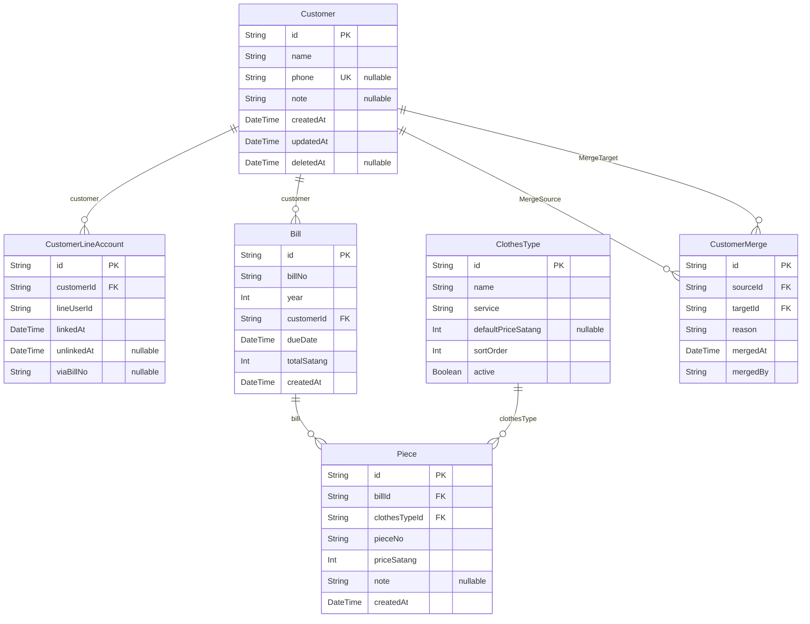

# ER Diagram

> ⚠️ **ไฟล์นี้ generate จาก `prisma/schema.prisma` ห้ามแก้ด้วยมือ**
> สร้างใหม่ด้วย `npm run db:erd`

6 ตาราง · 6 ความสัมพันธ์

## Composite unique

| ตาราง | คอลัมน์ |
|---|---|
| `CustomerLineAccount` | `customerId` + `lineUserId` |
| `Bill` | `billNo` + `year` |
| `ClothesType` | `name` + `service` |
| `Piece` | `billId` + `pieceNo` |

## สิ่งที่ ERD ไม่ได้บอก

ข้อจำกัดบางอย่างอยู่ในกฎทางธุรกิจ ไม่ได้อยู่ในโครงสร้างตาราง

- **`Customer.phone` เป็น unique แต่เป็น null ได้ไม่จำกัด**
  Postgres ถือว่า NULL แต่ละค่าไม่เท่ากัน · จำเป็นเพราะ ~20% ของบิลไม่มีเบอร์
- **`CustomerLineAccount` เป็นหลายต่อหลาย**
  ลูกค้า 1 รายผูกได้หลายบัญชี LINE (สามีภรรยา) และบัญชี LINE 1 บัญชี
  ผูกได้หลายลูกค้า (คนรับผ้าแทนทั้งบ้าน)
- **`unlinkedAt` ไม่ใช่การลบ** · ยกเลิกการผูกแล้วแถวยังอยู่ เพื่อให้ตรวจย้อนหลังได้
- **`totalSatang` เป็นสตางค์ ไม่ใช่บาท** · ห้ามใช้ Float กับเงิน
- **`deletedAt` คือ soft delete** · ทุก query ต้องกรอง `deletedAt: null`
  และก่อน soft delete ต้องเคลียร์ `phone` เป็น null ไม่งั้นเบอร์นั้นจะถูกจองไว้ตลอดไป

## วิธีดูรูป

| วิธี | ทำยังไง |
|---|---|
| **GitHub** | เปิดไฟล์นี้บน GitHub · render Mermaid ให้เอง |
| **VS Code** | ติดตั้ง *Markdown Preview Mermaid Support* แล้วกด `⇧⌘V` |
| **เบราว์เซอร์** | `npm run db:erd:html` แล้วเปิด `docs/ERD.html` |
| **เป็นไฟล์รูป** | `npx -y @mermaid-js/mermaid-cli -i docs/ERD.md -o docs/ERD.svg` |

SVG เป็น vector จึงคมเมื่อพิมพ์ · ใช้ในรายงาน IS ได้โดยไม่แตก
