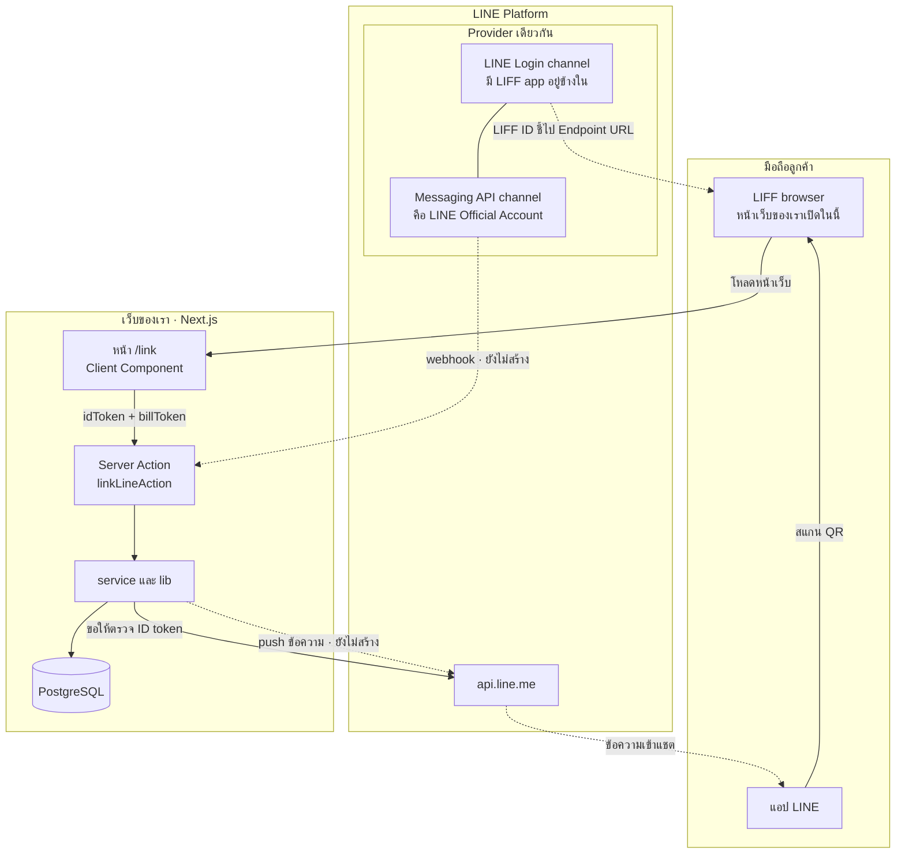
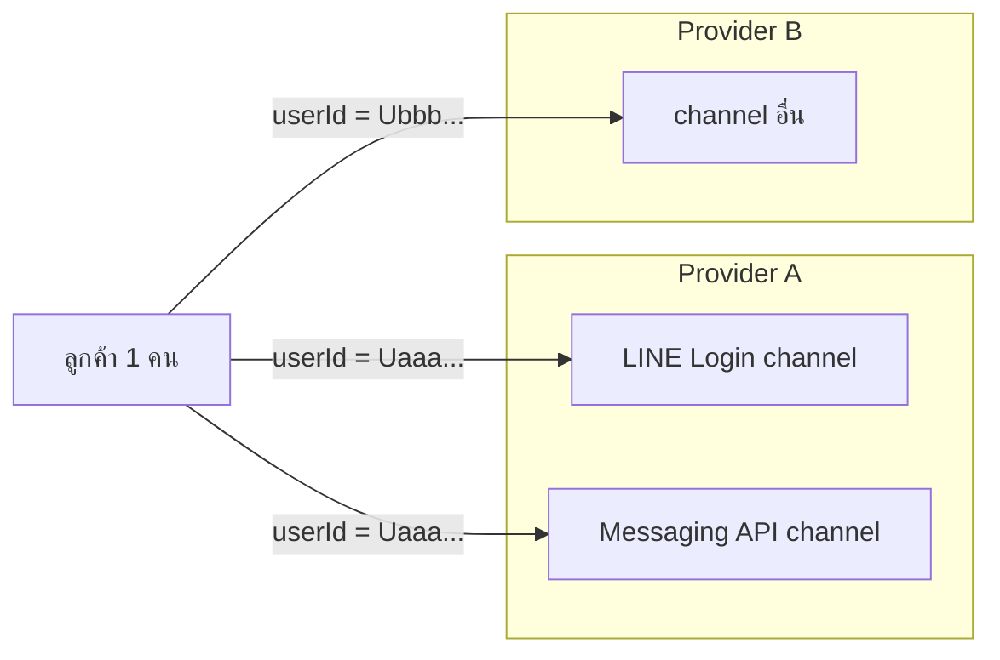
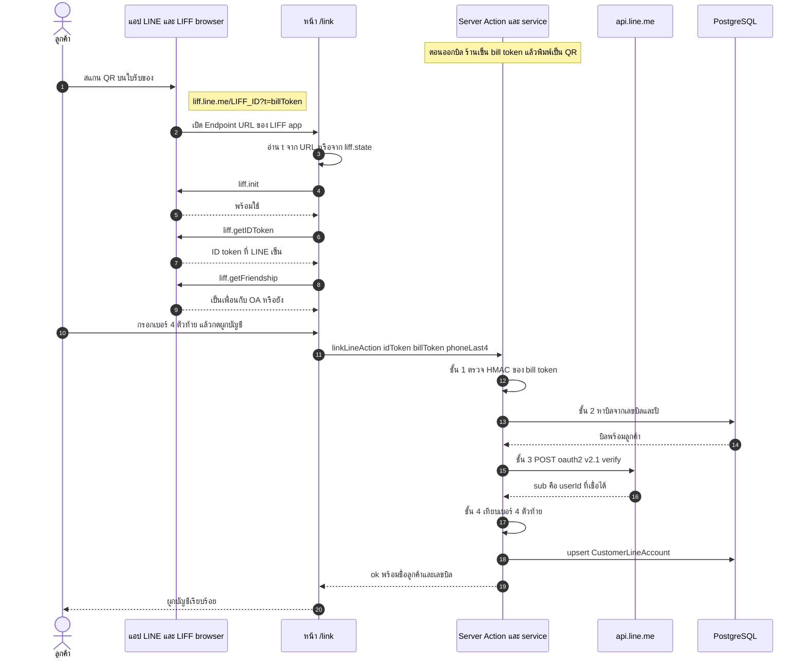
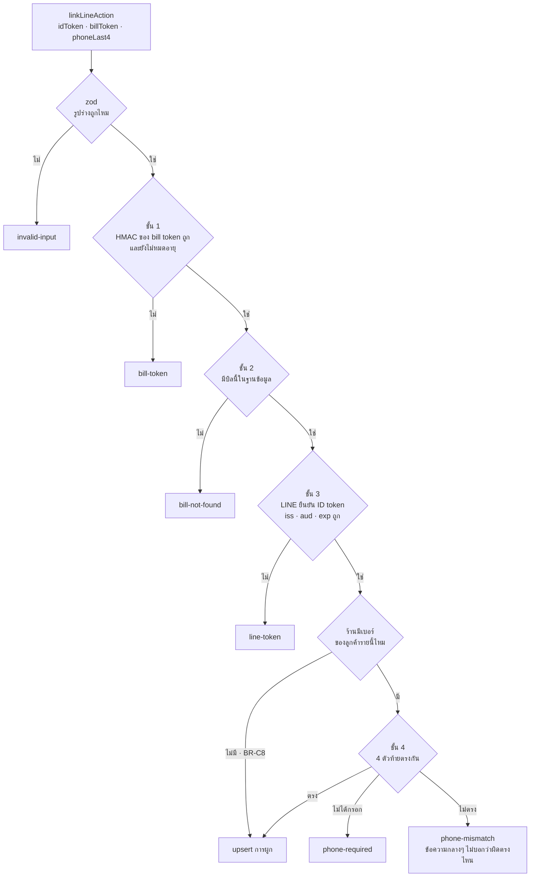
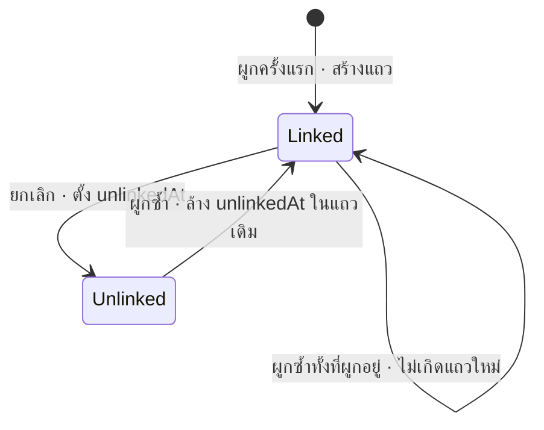
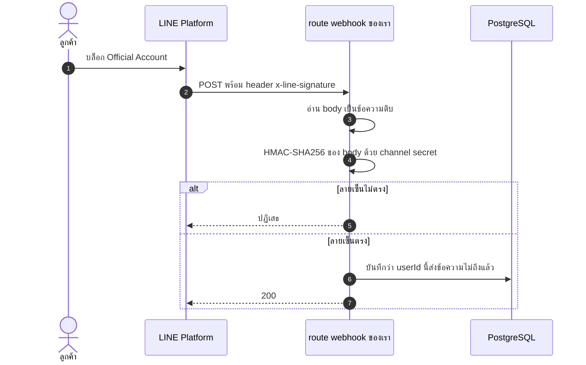
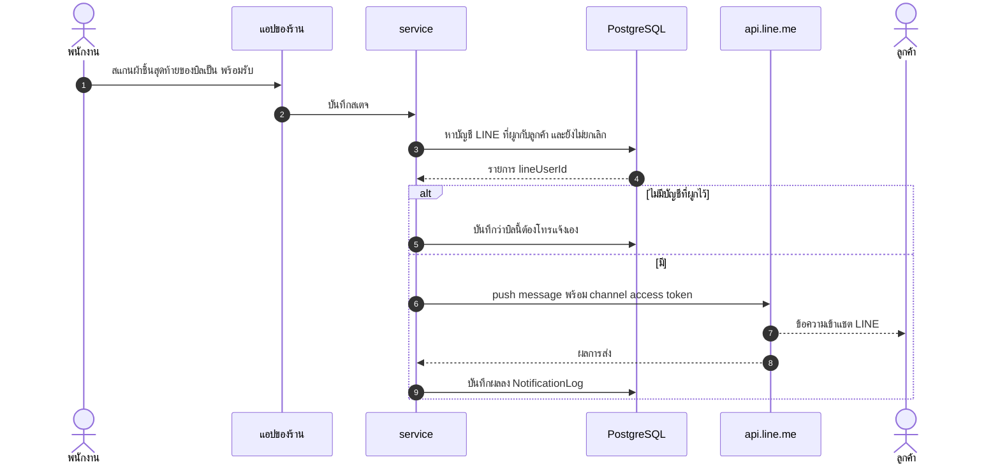

# LINE ทำงานกับเว็บแอปยังไง · อธิบายคู่กับไฟล์จริงในโปรเจกต์นี้

เอกสารนี้ตอบคำถามเดียว: **เว็บของเรากับ LINE คุยกันทางไหนบ้าง และแต่ละทางเชื่อได้แค่ไหน**

สถานะของแต่ละส่วนเขียนกำกับไว้ทุกหัวข้อ

| เครื่องหมาย | ความหมาย |
|---|---|
| ✅ สร้างแล้ว | มีโค้ดอยู่ใน repo และมี test |
| ⬜ ยังไม่สร้าง | เป็นแบบที่ตั้งใจไว้ · ยังไม่มีโค้ด |

สารบัญ

1. [ภาพรวม · ใครคุยกับใคร](#1-ภาพรวม--ใครคุยกับใคร)
2. [สี่ชิ้นส่วนของ LINE ที่โปรเจกต์นี้ใช้](#2-สี่ชิ้นส่วนของ-line-ที่โปรเจกต์นี้ใช้)
3. [สี่ช่องทางระหว่างเว็บกับ LINE](#3-สี่ช่องทางระหว่างเว็บกับ-line)
4. [โทเคนสี่ชนิด · อย่าสับสนกัน](#4-โทเคนสี่ชนิด--อย่าสับสนกัน)
5. [flow ผูกบัญชี · ตั้งแต่สแกน QR ถึงฐานข้อมูล](#5-flow-ผูกบัญชี--ตั้งแต่สแกน-qr-ถึงฐานข้อมูล) ✅
6. [การตรวจ 4 ชั้นฝั่งเซิร์ฟเวอร์](#6-การตรวจ-4-ชั้นฝั่งเซิร์ฟเวอร์) ✅
7. [วงจรชีวิตของการผูกบัญชี](#7-วงจรชีวิตของการผูกบัญชี) ✅
8. [webhook · LINE เรียกหาเรา](#8-webhook--line-เรียกหาเรา) ⬜
9. [ส่งข้อความแจ้งเตือน](#9-ส่งข้อความแจ้งเตือน) ⬜
10. [ตัวแปร environment](#10-ตัวแปร-environment)
11. [สิ่งที่พังเงียบ](#11-สิ่งที่พังเงียบ)

---

## 1 · ภาพรวม · ใครคุยกับใคร

> ภาพเดียวกันนี้แบบละเอียดและแก้ไขได้อยู่ที่ [`line-architecture.drawio`](line-architecture.drawio)
> เปิดด้วย [app.diagrams.net](https://app.diagrams.net) หรือ extension *Draw.io Integration* ใน VS Code
> แล้ว export เป็น PNG/SVG สำหรับรายงาน IS ได้



เส้นทึบคือสิ่งที่ทำงานแล้ว · เส้นประคือสิ่งที่ LINE ตั้งค่าให้หรือสิ่งที่ยังไม่ได้สร้าง

ข้อที่ต้องจำจากภาพนี้: **หน้าเว็บของเราไม่ได้ "อยู่ใน" LINE** · LINE แค่เปิดเบราว์เซอร์ตัวหนึ่ง
ไปที่ URL ของเรา แล้วใส่ SDK ให้เราถามได้ว่า "คนที่เปิดอยู่คือใคร"
ทุกอย่างที่เหลือเป็นเว็บธรรมดา และต้องระวังเท่ากับเว็บธรรมดา

---

## 2 · สี่ชิ้นส่วนของ LINE ที่โปรเจกต์นี้ใช้

| ชิ้นส่วน | คืออะไร | ใช้ทำอะไรที่นี่ |
|---|---|---|
| **Provider** | กล่องที่รวม channel ของเจ้าของเดียวกัน | กำหนดว่า `userId` ของลูกค้าจะเป็นค่าไหน |
| **LINE Login channel** | channel สำหรับยืนยันตัวตน | ออก ID token · เป็นที่อยู่ของ LIFF app |
| **LIFF app** | ทะเบียนที่บอกว่า LIFF ID นี้เปิด URL ไหน | ทำให้ `https://liff.line.me/<LIFF ID>` เปิดหน้า `/link` ของเรา |
| **Messaging API channel** | channel ของ Official Account | ส่งข้อความหาลูกค้า · รับ webhook |

### ทำไม Provider สำคัญที่สุด

`userId` ของลูกค้าคนเดียวกัน **ไม่เท่ากันในแต่ละ Provider**



เราได้ `userId` มาจาก LINE Login channel (ตอนผูกบัญชี) แล้วเอาไปใช้กับ
Messaging API channel (ตอนส่งข้อความ) · สองอย่างนี้ต่อกันได้**เฉพาะเมื่อสอง channel
อยู่ใน Provider เดียวกัน** ถ้าไม่ใช่ จะได้อาการ "ผูกสำเร็จแต่ข้อความไม่เคยถึง"
โดยไม่มี error ฝั่งการผูกให้เห็นเลย · คำเตือนนี้อยู่ใน `.env.example` ด้วย

### LIFF app ต้องอยู่ใต้ LINE Login channel

LINE ไม่ให้เพิ่ม LIFF app ใต้ Messaging API channel แล้ว
โปรเจกต์นี้จึงต้องมีสอง channel ไม่ใช่ channel เดียว

---

## 3 · สี่ช่องทางระหว่างเว็บกับ LINE

ทุกครั้งที่จะเพิ่ม feature เกี่ยวกับ LINE ให้ถามก่อนว่ามันอยู่ช่องทางไหนในสี่ช่องนี้
เพราะแต่ละช่องมีทิศทาง โทเคน และระดับความน่าเชื่อถือไม่เหมือนกัน

| # | ช่องทาง | ทิศทาง | ใครเริ่ม | สถานะ | ไฟล์ |
|---|---|---|---|---|---|
| 1 | **LIFF SDK** | เบราว์เซอร์ ↔ LINE | ลูกค้าเปิดหน้า | ✅ | `src/app/(customer)/link/page.tsx` |
| 2 | **ตรวจ ID token** | เซิร์ฟเวอร์เรา → LINE | เรา | ✅ | `src/lib/line-id-token.ts` |
| 3 | **Webhook** | LINE → เซิร์ฟเวอร์เรา | LINE | ⬜ | ยังไม่มี |
| 4 | **Messaging API** | เซิร์ฟเวอร์เรา → LINE → แชต | เรา | ⬜ | ยังไม่มี |

ระดับความน่าเชื่อถือของข้อมูลที่ได้จากแต่ละช่อง

| ข้อมูล | มาจาก | เชื่อได้ไหม |
|---|---|---|
| `liff.getProfile().userId` | ช่อง 1 · ฝั่งเบราว์เซอร์ | **ไม่ได้** · แก้ได้ด้วย devtools |
| `sub` ที่ LINE ตอบกลับตอนตรวจ ID token | ช่อง 2 · เซิร์ฟเวอร์ถาม LINE เอง | ได้ |
| `userId` ใน webhook ที่ลายเซ็นถูก | ช่อง 3 | ได้ · แต่ต้องตรวจลายเซ็นก่อน |

แถวแรกคือเหตุผลที่โปรเจกต์นี้ไม่เคยเรียก `liff.getProfile()` เลย

---

## 4 · โทเคนสี่ชนิด · อย่าสับสนกัน

| โทเคน | ใครออก | พิสูจน์อะไร | อยู่ที่ไหนในโปรเจกต์ |
|---|---|---|---|
| **Bill token** | เราเอง (HMAC) | "คนนี้ถือใบรับของจริงของบิลนี้" | `src/lib/bill-token.ts` |
| **ID token** | LINE (JWT) | "คนนี้คือ LINE user คนนี้" | ได้จาก `liff.getIDToken()` · ตรวจที่ `src/lib/line-id-token.ts` |
| **Channel access token** | LINE | "request นี้มาจากร้านเรา" · ใช้ส่งข้อความ | `LINE_CHANNEL_ACCESS_TOKEN` · ยังไม่ถูกใช้ |
| **Channel secret** | LINE | ใช้ตรวจว่า webhook มาจาก LINE จริง | `LINE_CHANNEL_SECRET` · ยังไม่ถูกใช้ |

สองตัวแรกเดินทางผ่านมือลูกค้า จึงต้องเซ็นและต้องตรวจ
สองตัวหลังอยู่บนเซิร์ฟเวอร์เท่านั้น **ห้ามมี `NEXT_PUBLIC_` นำหน้าเด็ดขาด**
เพราะตัวแปรที่ขึ้นต้นแบบนั้นจะถูกฝังลงใน JavaScript ที่ส่งไปเบราว์เซอร์

ID token กับ access token ของ LINE Login เป็นคนละอย่างกัน ·
access token ใช้เรียก API แทนผู้ใช้ ส่วน ID token ใช้บอกว่าผู้ใช้คือใคร
โปรเจกต์นี้ต้องการรู้แค่ว่าเป็นใคร จึงใช้ ID token อย่างเดียว

---

## 5 · flow ผูกบัญชี · ตั้งแต่สแกน QR ถึงฐานข้อมูล

✅ สร้างแล้ว



### โค้ดของแต่ละขั้น

| ขั้นในภาพ | ไฟล์ | ฟังก์ชัน |
|---|---|---|
| เซ็น bill token + สร้าง URL | `src/lib/bill-token.ts` | `createBillToken` · `buildLiffUrl` |
| สร้างรายการลิงก์ของทุกบิล | `src/modules/bill/service.ts` | `listBillLinks` |
| แสดง QR (ตอนนี้เป็นหน้า dev) | `src/app/(front-office)/dev/qr/page.tsx` | — |
| 3–10 ทั้งหมดฝั่งเบราว์เซอร์ | `src/app/(customer)/link/page.tsx` | `useEffect` ตัวเดียว |
| 12 ส่งขึ้นเซิร์ฟเวอร์ | `src/app/(customer)/link/page.tsx` | `submit` |
| ตรวจรูปร่าง input | `src/modules/customer/schema.ts` | `linkLineSchema` |
| 13–19 | `src/modules/customer/service.ts` | `linkLineAccount` |
| 15–16 ถาม LINE | `src/lib/line-id-token.ts` | `verifyLineIdToken` |
| 18 เขียนฐานข้อมูล | `src/modules/customer/repository.ts` | `upsertLink` |

### สามจุดในโค้ดที่ควรเปิดดู

**ก. หน้า `/link` ไม่เคยส่ง `userId`** · ดู `submit` ใน `link/page.tsx`

```ts
const res = await linkLineAction({
  idToken: idToken.current,
  billToken: billToken.current,
  phoneLast4: last4 || undefined,
});
```

และ `linkLineSchema` ใน `schema.ts` **ไม่มีฟิลด์ `lineUserId`** โดยตั้งใจ
ต่อให้มีคนยิง request เองแล้วแนบ `lineUserId` มา zod ก็ทิ้งไป
`userId` มีทางเข้าระบบทางเดียวคือค่า `sub` ที่ LINE ตอบกลับมาให้เซิร์ฟเวอร์

**ข. โทเคนมาได้สองทาง** · ดูต้น `useEffect` ใน `link/page.tsx`

ตอน LIFF เปิดหน้าครั้งแรก query string ของเราอาจถูกห่ออยู่ใน `liff.state`
แล้วค่อยถูกคลี่กลับหลัง `liff.init()` · โค้ดจึงอ่าน `?t=` ก่อน ถ้าไม่มีค่อยแกะจาก `liff.state`

**ค. `import("@line/liff")` เป็น dynamic import** · ไม่ใช่ `import` บนหัวไฟล์

LIFF SDK แตะ `window` ตั้งแต่ตอนถูกโหลด · Client Component ยังถูก render บนเซิร์ฟเวอร์
หนึ่งรอบก่อนเสมอ (ดู `docs/NEXTJS.md` ข้อ 4) ซึ่งไม่มี `window` · จึงต้องโหลดใน `useEffect`
ที่รันเฉพาะในเบราว์เซอร์

---

## 6 · การตรวจ 4 ชั้นฝั่งเซิร์ฟเวอร์

✅ สร้างแล้ว · `linkLineAccount` ใน `src/modules/customer/service.ts` · กฎ BR-C7 และ BR-C8



| ชั้น | กันอะไร | ต้นทุน |
|---|---|---|
| 1 · bill token | เดาเลขบิล (เลขบิลเป็นเลขเรียง เดาต่อได้ทั้งหมด) | คำนวณในเครื่อง |
| 2 · หาบิล | โทเคนที่เซ็นถูกแต่บิลถูกลบไปแล้ว | query 1 ครั้ง |
| 3 · ID token | ปลอม `userId` จากเบราว์เซอร์ | ยิงออกไปหา LINE · ช้าที่สุด |
| 4 · เบอร์ 4 ตัวท้าย | คนเก็บใบรับของที่หล่นได้ | ในหน่วยความจำ |

เรียงจากถูกไปแพง · request ขยะส่วนใหญ่ตกตั้งแต่ชั้น 1 โดยไม่ต้องยิงหา LINE เลย

### ชั้น 3 ทำอะไรจริงๆ

`verifyLineIdToken` ใน `src/lib/line-id-token.ts` ส่ง `id_token` กับ `client_id`
ไปที่ `https://api.line.me/oauth2/v2.1/verify` แล้วตรวจคำตอบซ้ำเองอีกรอบ

| ตรวจ | ทำไม |
|---|---|
| `iss === "https://access.line.me"` | โทเคนต้องออกโดย LINE |
| `aud === LINE_LOGIN_CHANNEL_ID` | โทเคนต้องออก**ให้ channel ของเรา** · ไม่ใช่โทเคนจริงของแอปคนอื่นที่เอามาใช้ซ้ำ |
| `exp` ยังไม่ถึง | โทเคนเก่าที่หลุดไปใช้ไม่ได้ |
| มี `sub` | ค่านี้คือ `userId` ที่จะเขียนลงฐานข้อมูล |

### ชั้น 4 และ BR-C8

ประมาณ 20% ของบิลไม่มีเบอร์โทร · ถ้าบังคับชั้น 4 ทุกกรณี ลูกค้ากลุ่มนี้จะผูกไม่ได้เลย
ทั้งที่เป็นกลุ่มที่ร้านติดต่อไม่ได้และควรได้ช่องทางนี้มากที่สุด
จึงข้ามชั้น 4 เมื่อร้านไม่มีเบอร์ · แลกกับการที่บิลกลุ่มนี้เหลือการป้องกัน 3 ชั้น

การเทียบใช้ `last4Matches` ใน `src/lib/phone.ts` ซึ่งเทียบแบบเวลาคงที่

---

## 7 · วงจรชีวิตของการผูกบัญชี

✅ สร้างแล้ว · ตาราง `CustomerLineAccount` ใน `prisma/schema.prisma`



| กฎ | ความหมาย | โค้ด |
|---|---|---|
| BR-C1 | ลูกค้า 1 รายผูกได้หลายบัญชี LINE | ตารางแยก ไม่ใช่คอลัมน์ใน `Customer` |
| BR-C2 | บัญชี LINE 1 บัญชีผูกได้หลายลูกค้า | `findCustomersByLineUser` ใน `repository.ts` |
| BR-C5 | ยกเลิกไม่ใช่การลบแถว | `unlink` ตั้ง `unlinkedAt` |
| BR-C6 | ผูกซ้ำเปิดแถวเดิม | `upsertLink` + `@@unique([customerId, lineUserId])` |

การยกเลิกต้องส่ง ID token มาด้วยเหมือนตอนผูก (`unlinkLineAccount` ใน `service.ts`)
ไม่งั้นใครรู้ `customerId` ก็ยกเลิกการผูกของคนอื่นได้ · ฟังก์ชันนี้มีแล้ว แต่**ยังไม่มีหน้าจอ**ให้ลูกค้ากด

---

## 8 · webhook · LINE เรียกหาเรา

⬜ ยังไม่สร้าง · ส่วนนี้คือแบบที่ตั้งใจไว้

ช่องทางนี้กลับทิศกับที่ผ่านมาทั้งหมด — LINE เป็นฝ่ายยิง `POST` มาที่ URL ของเรา
เมื่อมีเหตุการณ์เกิดกับ Official Account

| event | เกิดเมื่อ | ทำไมเราต้องรู้ |
|---|---|---|
| `follow` | ลูกค้าเพิ่มเพื่อนหรือปลดบล็อก | ส่งข้อความหาได้แล้ว |
| `unfollow` | ลูกค้าบล็อก OA | ส่งไปก็ไม่ถึง · ต้องเลิกนับว่าติดต่อได้ |
| `message` | ลูกค้าพิมพ์มาในแชต | ตอบกลับด้วย reply ได้โดยไม่เสียโควตา |



### ข้อที่ผิดง่ายที่สุดของ webhook

ลายเซ็นคำนวณจาก **body ดิบทุกไบต์** · ถ้า `await request.json()` ก่อนแล้วค่อย
`JSON.stringify` กลับมาคำนวณ ลายเซ็นจะไม่ตรงเป็นบางครั้ง เพราะลำดับ key
และช่องว่างอาจไม่เหมือนต้นฉบับ · ต้อง `await request.text()` ก่อน ตรวจลายเซ็น แล้วค่อย `JSON.parse`

### ทำไม webhook เป็น Route Handler ไม่ใช่ Server Action

Server Action ถูกเรียกจากหน้าจอของเราเอง · webhook ถูกเรียกจากระบบภายนอก
ที่กำหนดรูปแบบ request มาแล้ว · จึงต้องเป็นไฟล์ `route.ts` ซึ่งจะเป็น**ไฟล์ API ไฟล์แรก**ของโปรเจกต์นี้
(ตำแหน่งที่วางไว้ใน `docs/ARCHITECTURE.md` คือ `src/app/api/line/webhook/route.ts`)

### ช่องโหว่ที่มีอยู่ตอนนี้เพราะยังไม่มี webhook

หน้า `/link` เช็ก `liff.getFriendship()` ตอนผูกครั้งเดียว · ถ้าลูกค้าบล็อก OA ทีหลัง
ระบบจะยังเชื่อว่าติดต่อได้ และไม่มีอะไรบอกเราเลยจนกว่าจะมี webhook `unfollow`

---

## 9 · ส่งข้อความแจ้งเตือน

⬜ ยังไม่สร้าง · ส่วนนี้คือแบบที่ตั้งใจไว้



### push กับ reply ไม่เหมือนกัน

| | Reply | Push |
|---|---|---|
| ใครเริ่มบทสนทนา | ลูกค้าพิมพ์มาก่อน | ร้านเริ่มเอง |
| ต้องมี | reply token จาก webhook · ใช้ได้ครั้งเดียวและหมดอายุเร็ว | `userId` |
| นับโควตาไหม | ไม่นับ | **นับ** |

"ผ้าเสร็จแล้ว" เป็นร้านเริ่มเอง จึงเป็น push และกินโควตาข้อความของแผน OA

> ⚠️ **ยังไม่ได้ตรวจโควตาจริงของแผน OA ที่ร้านใช้** (รายการ S4 ในงานค้าง)
> ร้านออกราว 20,000 บิลต่อปี · ถ้าแจ้งบิลละครั้งและลูกค้าผูกครบทุกบิล
> จะเป็นราว 1,700 ข้อความต่อเดือน · ต้องเทียบกับโควตาของแผนก่อนเปิดใช้
> เอกสารนี้ไม่ใส่ตัวเลขโควตาเพราะ LINE ปรับได้ ให้ดูจากหน้าแผนของ LINE โดยตรง

ตาราง `NotificationLog` อยู่ใน `docs/ERD-TARGET.md` ยังไม่ได้ migrate ·
มีไว้เพราะเวลาลูกค้าบอกว่าไม่ได้รับแจ้ง ร้านต้องมีหลักฐานว่าส่งแล้วหรือยัง

---

## 10 · ตัวแปร environment

ดูคำอธิบายเต็มใน `.env.example`

| ตัวแปร | มาจาก | ใช้ที่ | ถึงเบราว์เซอร์ไหม |
|---|---|---|---|
| `NEXT_PUBLIC_LIFF_ID` | LINE Login channel → LIFF | `link/page.tsx` · `bill-token.ts` | **ถึง** · ไม่เป็นความลับ |
| `LINE_LOGIN_CHANNEL_ID` | LINE Login channel → Basic settings | `line-id-token.ts` | ไม่ถึง |
| `BILL_TOKEN_SECRET` | สร้างเอง | `bill-token.ts` | ไม่ถึง |
| `LINE_CHANNEL_ACCESS_TOKEN` | Messaging API channel | ยังไม่ถูกใช้ | ไม่ถึง |
| `LINE_CHANNEL_SECRET` | Messaging API channel | ยังไม่ถูกใช้ | ไม่ถึง |

`BILL_TOKEN_SECRET` เปลี่ยนไม่ได้หลังพิมพ์ใบรับของไปแล้ว · QR เก่าทุกใบจะใช้ไม่ได้ทันที

### สิ่งที่ต้องตั้งใน LINE Developers Console

| ที่ไหน | ตั้งอะไร | ถ้าไม่ตั้ง |
|---|---|---|
| LIFF app → Scopes | เปิด `openid` | `liff.getIDToken()` คืน `null` · ผูกไม่ได้เลย |
| LIFF app → Endpoint URL | URL ของหน้า `/link` ที่เป็น `https` | สแกน QR แล้วเปิดไม่ขึ้น |
| LINE Login channel → Linked OA | ผูกกับ Official Account ของร้าน | `liff.getFriendship()` ใช้ไม่ได้ |
| ทั้งสอง channel | อยู่ใน Provider เดียวกัน | ผูกสำเร็จแต่ส่งข้อความไม่ถึง |

จากการตรวจครั้งล่าสุด scope `openid` ยังไม่ได้เปิด และ Endpoint URL ยังไม่ใช่ URL ที่ใช้ได้จริง
สองข้อนี้ต้องแก้ก่อนจะทดสอบ flow ผูกบัญชีบนมือถือได้

---

## 11 · สิ่งที่พังเงียบ

รายการนี้คือเหตุผลที่เอกสารนี้มีอยู่ · ทุกข้อไม่มี error ให้เห็นตอนที่มันผิด

| อาการ | สาเหตุ | กันไว้ที่ไหน |
|---|---|---|
| ผูกสำเร็จ แต่ข้อความไม่เคยถึง | สอง channel อยู่คนละ Provider | คำเตือนใน `.env.example` · ยังไม่มีการตรวจอัตโนมัติ |
| ผูกสำเร็จ แต่ข้อความไม่ถึง | ลูกค้าไม่ได้เพิ่มเพื่อน | `liff.getFriendship()` ใน `link/page.tsx` เตือนบนจอ |
| เคยส่งถึง แล้วเลิกถึง | ลูกค้าบล็อก OA ทีหลัง | ⬜ ต้องมี webhook `unfollow` |
| คนอื่นเห็นสถานะผ้าของเรา | เชื่อ `userId` จากเบราว์เซอร์ | `linkLineSchema` ไม่มีฟิลด์ `lineUserId` |
| ผูกบิลคนอื่นด้วยการเดาเลข | QR มีแค่เลขบิล | HMAC ใน `bill-token.ts` |
| `getIDToken()` คืน `null` | ไม่ได้เปิด scope `openid` | `link/page.tsx` แสดงข้อความบอกสาเหตุ |
| build ผ่านในเครื่อง พังบน Vercel | LIFF SDK แตะ `window` ตอน build | dynamic import ใน `link/page.tsx` |
| webhook ถูกปฏิเสธเป็นบางครั้ง | คำนวณลายเซ็นจาก JSON ที่ parse แล้ว | ⬜ ต้องใช้ body ดิบ |

### งานที่ยังค้างฝั่ง LINE

- [ ] เปิด scope `openid` และตั้ง Endpoint URL จริง
- [ ] webhook `follow` / `unfollow` พร้อมตรวจลายเซ็นจาก body ดิบ
- [ ] จำกัดจำนวนครั้งที่เรียก `linkLineAction` · ตอนนี้เดาเบอร์ 4 ตัวท้ายได้ไม่จำกัดครั้ง
- [ ] หน้าจอยกเลิกการผูก (PDPA) · ฟังก์ชันฝั่งเซิร์ฟเวอร์มีแล้ว
- [ ] ตรวจโควตาข้อความของแผน OA (S4)
- [ ] ส่งข้อความแจ้งเตือนและตาราง `NotificationLog`

---

## อ่านต่อ

| ไฟล์ | เนื้อหา |
|---|---|
| [NEXTJS.md](NEXTJS.md) | Server/Client Component และ Server Action ที่ flow นี้ใช้ |
| [CODE-WALKTHROUGH.md](CODE-WALKTHROUGH.md) | อธิบายทุกไฟล์ทีละบรรทัด |
| [ERD.md](ERD.md) | ตาราง `CustomerLineAccount` ที่มีจริง |
| [ERD-TARGET.md](ERD-TARGET.md) | `NotificationLog` ที่ยังไม่ได้สร้าง |
