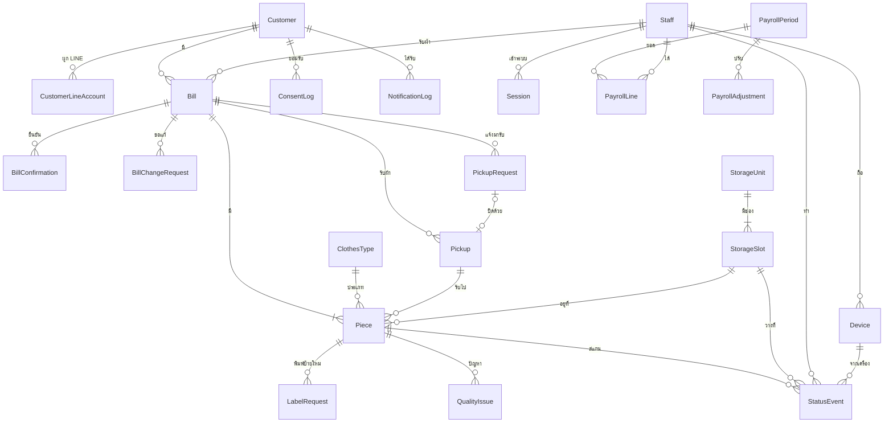
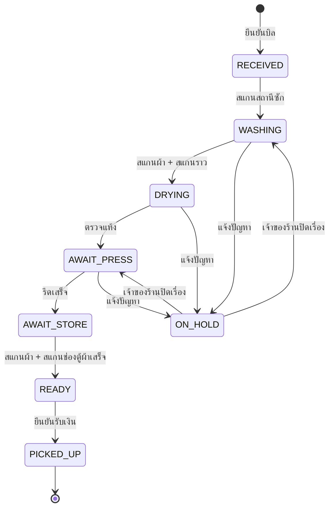
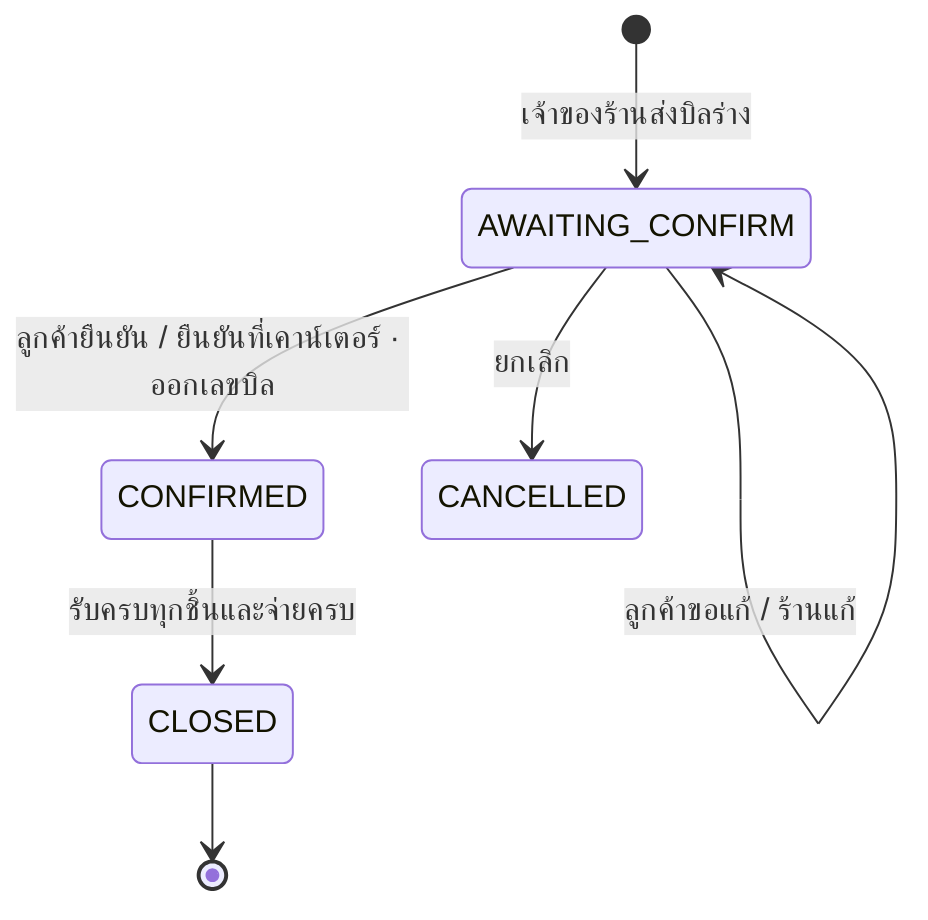
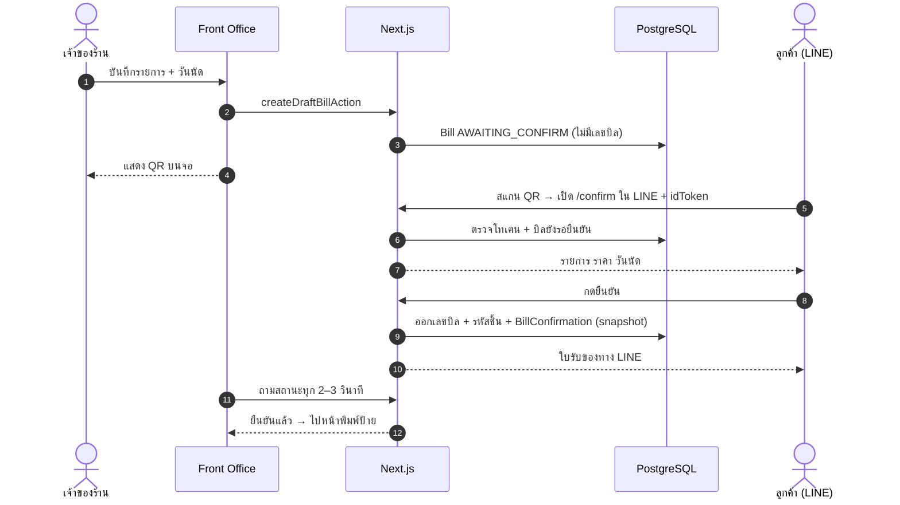
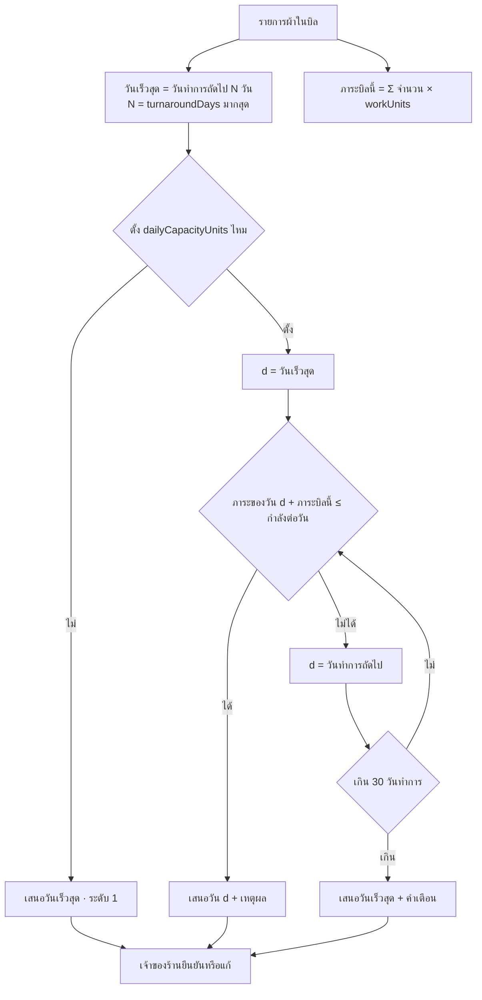
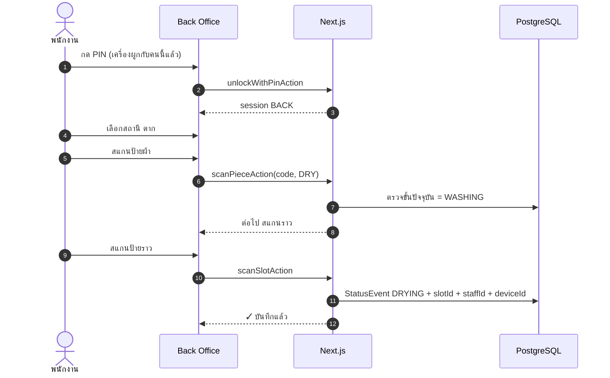

# ศรีบริสุทธิ์ ซักแห้ง · System Spec (สำหรับนักพัฒนา)

> เอกสารนี้คือ **แหล่งความจริงของแบบระบบ** สำหรับการพัฒนา · ส่งออกจาก artifact `sriborisud-system-design` เมื่อ 19 พ.ย. 2026 · เพิ่ม F23 เมื่อ 26 พ.ย. 2026
> ถ้าแบบเปลี่ยน ให้แก้ไฟล์นี้ (และ `spec.json`) พร้อมโค้ดใน PR เดียวกัน · อ่าน `AGENTS.md` ที่ root ก่อนเริ่มงาน

## สารบัญ

1. การตัดสินใจหลัก
2. 3 แอป
3. ลำดับการสร้าง
4. หลักการเขียนโค้ด
5. ฟีเจอร์ F01–F23
6. ฐานข้อมูล
7. API
8. หน้าจอ
9. Flow และสถานะ
10. สิทธิ์และความปลอดภัย
11. ตัวแปรสภาพแวดล้อม
12. ค่าตั้งค่า
13. คำถามค้าง

## 1. การตัดสินใจหลัก

| เรื่อง | ตัดสินใจ |
|---|---|
| วันนัดรับ | ระดับ 2: จำนวนวันต่อประเภทผ้า + วันหยุดร้าน แล้วเทียบงานที่สัญญาไว้กับกำลังต่อวัน · เจ้าของร้านยืนยันเสมอ · ระดับ 3 (เรียนรู้จากการสแกน) เป็นงานอนาคต |
| โครงสร้าง | Next.js ตัวเดียวทั้ง frontend และ backend · ไม่แยก FE/BE |
| โฮสต์ | Next.js บน Vercel · PostgreSQL บน Supabase เชื่อมผ่าน Prisma |
| แคช / ตัวนับ | ไม่ใช้ Redis · นับจำนวนครั้งและเก็บ OTP ใน Postgres |
| ลูกค้า | ใช้ LINE LIFF ไม่ต้องติดตั้งแอป · LINE ไม่ให้เบอร์โทรกับธุรกิจในไทย จึงยืนยันเบอร์ด้วย OTP ทาง SMS |
| ใบรับของ | ไม่พิมพ์กระดาษ · ส่งทาง LINE และสร้าง PDF จากฐานข้อมูลเมื่อขอ |
| ป้ายผ้า | พิมพ์ป้ายบาร์โค้ดรายชิ้น · ยังพิมพ์อยู่ |
| ตำแหน่งผ้า | สแกนป้ายช่องในตู้รอซัก ราวตาก และตู้ผ้าเสร็จ · เจ้าของร้านเพิ่มตู้และราวได้ ระบบออกเลขรันให้ |
| อุปกรณ์พนักงาน | ร้านให้เครื่องแต่ละคน · ผูกเครื่องกับคน · ปลดล็อกด้วย PIN |
| ลูกค้าไม่พอใจ | ไม่ทำทาง ส่งซักใหม่ ในขั้นส่งมอบ · ปัญหาคุณภาพบันทึกผ่านการแจ้งปัญหา |
| ยืนยันบิล | ข้อเสนอ: ลูกค้ายืนยันบิลใน LINE ก่อนออกเลขบิล · มีทางยืนยันที่เคาน์เตอร์สำรอง |
| ช่องทาง LINE | ร้านมี LINE OA อยู่แล้ว แต่ระบบใช้ OA ใหม่ · Login channel กับ Messaging API ต้องอยู่ใน Provider เดียวกัน · ต้องชวนลูกค้าเดิมเพิ่มเพื่อน OA ใหม่ |
| มารับผ้า | ลูกค้าแจ้งก่อนมารับตามกติกาเดิมของร้าน และเลือกช่วงเวลา 30 นาที ช่วงละไม่เกิน 15 บิล (ปรับได้) · ไม่บังคับจอง walk-in ยังรับได้ แต่ผู้ที่จองได้รับก่อน · ระบบทำรายการเตรียมผ้า |

## 1b. เงื่อนไขของร้าน (จากใบรับของเดิม)

| ข้อ | เงื่อนไข | ระบบรองรับอย่างไร |
|---|---|---|
| TC1 | ผ้าเกินกำหนด 30 วันยังไม่มารับ และต้องซักใหม่ คิดค่าซักเพิ่มเป็น 2 เท่า | ระบบนับวันหลังวันนัด แสดง 'เกิน 30 วัน' ในบิลและหน้าหลัก · ถ้าเจ้าของร้านเลือกซักใหม่ ระบบเพิ่มค่าซักใหม่ = ราคาชิ้นนั้น × 2 (ปรับได้) |
| TC2 | ใบรับผ้าหายต้องรีบแจ้งร้าน · ถ้ามีผู้นำใบรับมารับไปก่อนแจ้ง ร้านไม่รับผิดชอบ · ถ้าผ้ายังอยู่ ต้องนำใบแจ้งความมาแสดง | ใบรับของอยู่ใน LINE จึงหายยากขึ้น · ส่งมอบให้ผู้ถือ QR ของบิล หรือลูกค้าที่ยืนยันตัวตนด้วย LINE · ใบรับหาย: เจ้าของร้านกด 'แจ้งใบรับหาย' ระบบยกเลิก QR เดิมทันที และบันทึกว่ารับใบแจ้งความแล้ว |
| TC3 | ร้านทำผ้าเสียหาย ชดใช้ตามสภาพที่เห็นสมควร ไม่เกิน 8 เท่าของค่าซักชิ้นนั้น | ราคารายชิ้นถูกล็อกไว้ตอนรับผ้า จึงคำนวณเพดานชดใช้ (× 8) ได้ · การจัดการความเสียหายยังทำนอกระบบ |
| TC4 | ใบรับมีกำหนด 1 เดือน ไม่มารับตามกำหนด ร้านไม่รับผิดชอบ | เตือนลูกค้าก่อนครบ 30 วัน (F15) · แสดงเงื่อนไขทั้ง 4 ข้อในหน้ายืนยันบิล (F08) และเก็บเวอร์ชันที่ลูกค้ายอมรับไว้ในสำเนาการยืนยัน |

ตัวเลขในเงื่อนไขเป็นค่าตั้งค่า (terms.*) ไม่เขียนในโค้ด

## 2. 3 แอป

| แอป | ผู้ใช้ | อุปกรณ์ | เข้าระบบ | โฟลเดอร์ |
|---|---|---|---|---|
| Front Office | เจ้าของร้าน | คอมพิวเตอร์ที่เคาน์เตอร์ | ชื่อผู้ใช้ + รหัสผ่าน | `src/app/(front-office)` |
| Back Office | ผู้ช่วย · ช่างซัก · ช่างรีด | มือถือของร้าน คนละเครื่อง | เครื่องที่ผูกกับคน + PIN | `src/app/(floor)` |
| Customer App | ลูกค้า | มือถือ เปิดใน LINE (LIFF) | ตัวตนจาก LINE · ไม่มีรหัสผ่าน | `src/app/(customer)` |

ทั้ง 3 แอปอยู่ใน Next.js โปรเจกต์เดียว (App Router) ใช้ฐานข้อมูลเดียวกัน · แต่ละ route group มี root layout ของตัวเอง

## 3. ลำดับการสร้าง

ทำตามลำดับ phase · ภายใน phase เรียงตามที่เขียน

| Phase | ฟีเจอร์ |
|---|---|
| 1. ก่อนใส่ข้อมูลจริง | F01 เข้าระบบ · ปิด /dev/qr · F06 ราคาจริง |
| 2. รับผ้าแบบใหม่ | F07 บิลร่าง · F19 วันนัดระดับ 2 · F08 ยืนยันบิล · F09 ป้ายผ้า · F04 ลงทะเบียน + OTP |
| 3. งานหลังร้าน | F02 พนักงานและเครื่อง · F10 ตู้และราว · F11 แอปสแกน · F12 รายการน่าจะแห้ง |
| 4. ส่งมอบและติดต่อลูกค้า | F14 แจ้งพร้อมรับ · F16 ลูกค้าดูสถานะ · F23 แจ้งมารับล่วงหน้า · F17 ส่งมอบ · F15 เตือนค้างรับ |
| 5. สรุปผล | F18 ค่าแรง · F21 หน้าหลัก · F20 ตั้งค่า |

**Definition of done ของแต่ละฟีเจอร์**

1. แก้ `prisma/schema.prisma` + สร้าง migration (`npm run db:migrate -- --name <ชื่อ>`) + `npm run db:erd`
2. กฎธุรกิจอยู่ใน `service.ts` และมีเทสต์ vitest ครอบทุกข้อในหัวข้อ "กฎ" ของฟีเจอร์
3. Server Action ทุกตัว: guard บรรทัดแรก → parse ด้วย zod (ผิดคืน `invalid-input`) → เรียก service → `revalidatePath` ถ้าจำเป็น · ห้ามมีกฎธุรกิจใน actions.ts
4. หน้าจอครบตามตาราง "หน้าจอ" · ข้อความภาษาไทย · ใช้ design token จาก `src/app/globals.css`
5. `npm run typecheck && npm run lint && npm test && npm run build` ผ่าน
6. อัปเดตสถานะในไฟล์นี้และ `spec.json` (design → built)

## 4. หลักการเขียนโค้ด (มีอยู่แล้วในโปรเจกต์ ต้องทำตาม)

- **ชั้น**: `app/` (routing + UI) → `modules/<feature>/` (กฎธุรกิจ) → `lib/` (ไม่รู้เรื่องร้าน) · eslint `no-restricted-imports` บังคับอยู่
- **UI ห้ามแตะฐานข้อมูล** · ห้าม import `@/lib/db` หรือ `@prisma/client` ใน `src/app` และ `src/components`
- **import module ผ่าน `@/modules/<feature>` เท่านั้น** · `index.ts` export เฉพาะ actions และ types (อย่า export สิ่งที่ใช้ `node:crypto` ไปฝั่ง client)
- **โครงไฟล์ module**: `schema.ts` (zod) · `repository.ts` (Prisma อย่างเดียว) · `service.ts` (กฎ ทดสอบได้) · `actions.ts` (`"use server"`) · `index.ts`
- **Server Action** รับ `raw: unknown` แล้ว parse ด้วย zod เสมอ · คืน `Result<T>` = `{ ok: true, data } | { ok: false, code, message }` แบบเดียวกับ `modules/customer/service.ts` · guard ไม่ผ่านคืน `code: "unauthorized"`
- **เงิน** เก็บเป็นสตางค์ `Int` · ใช้ `lib/money.ts` · ห้าม Float
- **เบอร์โทร** ผ่าน `lib/phone.ts` เสมอ
- **ตัวตน LINE** มาจาก `lib/line-id-token.ts` เท่านั้น · ห้ามเชื่อ userId ที่ client ส่งมา
- **เวลา**: เก็บ UTC · แสดงและคำนวณ "วัน" ตามเวลาไทย (Asia/Bangkok)
- **ห้ามใส่ตัวเลขที่ร้านยังไม่ยืนยัน** (ราคา อัตราค่าแรง กำลังต่อวัน) ลงในโค้ด · ใช้ค่าในตาราง Setting หรือ `null` และแสดง "—"
- **ประวัติ**: StatusEvent เพิ่มอย่างเดียว · ข้อมูลที่มีประวัติใช้ปิดใช้งานหรือ soft delete ไม่ลบจริง
- **Transaction**: การเปลี่ยนสถานะผ้าต้องเขียน StatusEvent และ Piece.status/currentSlotId ใน `db.$transaction` เดียวกัน
- **Branch**: `feature/<ชื่อ>` → PR เข้า `develop` · ไม่ commit `.env*` ที่มีค่าจริง

## 5. ฟีเจอร์

| ID | ฟีเจอร์ | แอป | สถานะ |
|---|---|---|---|
| [F01](#f01) | เข้าระบบของเจ้าของร้าน | Front Office | ⬜ ยังไม่มีโค้ด |
| [F02](#f02) | พนักงานและเครื่อง | Front Office + Back Office | ⬜ ยังไม่มีโค้ด |
| [F03](#f03) | จัดการข้อมูลลูกค้า | Front Office | 🟦 บางส่วน |
| [F04](#f04) | ลงทะเบียนลูกค้าเองผ่าน LINE + OTP | Customer App | ⬜ ยังไม่มีโค้ด |
| [F05](#f05) | ผูก LINE ผ่านบิล | Customer App | ✅ สร้างแล้ว |
| [F06](#f06) | ประเภทผ้าและราคา | Front Office | 🟦 บางส่วน |
| [F07](#f07) | รับผ้าเข้า (บิลร่าง) | Front Office | 🟨 มีแล้ว ต้องแก้ |
| [F08](#f08) | ลูกค้ายืนยันบิล | Front Office + Customer App | ⬜ ยังไม่มีโค้ด |
| [F09](#f09) | เลขบิล ป้ายผ้า ใบรับของ | Front Office | 🟦 บางส่วน |
| [F10](#f10) | ตู้และราว | Front Office | ⬜ ยังไม่มีโค้ด |
| [F11](#f11) | แอปสแกน Back Office | Back Office | ⬜ ยังไม่มีโค้ด |
| [F12](#f12) | รายการน่าจะแห้ง | Back Office | ⬜ ยังไม่มีโค้ด |
| [F13](#f13) | แจ้งปัญหาคุณภาพ | Back Office + Front Office | ❌ ตัดออกจากขอบเขต |
| [F14](#f14) | แจ้งผ้าพร้อมรับ | ระบบ → LINE | ⬜ ยังไม่มีโค้ด |
| [F15](#f15) | เตือนผ้าค้างรับ และรายการโทร | ระบบ + Front Office | ⬜ ยังไม่มีโค้ด |
| [F16](#f16) | ลูกค้าดูสถานะ | Customer App | ⬜ ยังไม่มีโค้ด |
| [F17](#f17) | ส่งมอบและชำระเงิน | Front Office | ⬜ ยังไม่มีโค้ด |
| [F18](#f18) | สรุปยอดงานและค่าแรง | Front Office | ⬜ ยังไม่มีโค้ด |
| [F19](#f19) | วันนัดรับ (ระดับ 2 · ตัดสินใจแล้ว) | Front Office | 🟦 บางส่วน |
| [F20](#f20) | ตั้งค่าร้าน | Front Office | ⬜ ยังไม่มีโค้ด |
| [F21](#f21) | หน้าหลักของเจ้าของร้าน | Front Office | ⬜ ยังไม่มีโค้ด |
| [F22](#f22) | ข้อมูลส่วนบุคคล (PDPA) | Customer App + Front Office | 🟦 บางส่วน |
| [F23](#f23) | แจ้งมารับผ้าล่วงหน้า และรายการเตรียมผ้า | Customer App + Front Office | ⬜ ยังไม่มีโค้ด |

### F01

**เข้าระบบของเจ้าของร้าน** · Front Office · ⬜ ยังไม่มีโค้ด

หน้าที่สร้างแล้วยังเปิดโล่ง ใครรู้ URL ก็เห็นรายชื่อและเบอร์ลูกค้า · ต้องทำก่อนใส่ข้อมูลจริง

**ขั้นตอน**

1. เจ้าของร้านกรอกชื่อผู้ใช้และรหัสผ่าน
2. ระบบตรวจรหัสผ่าน (เข้ารหัสทางเดียว) และนับครั้งที่ผิด
3. ระบบสร้าง session เก็บใน cookie ที่ JavaScript อ่านไม่ได้
4. เลือก จำเครื่องนี้ ได้ · อยู่ในระบบนานตามค่าตั้ง
5. เรื่องสำคัญ (จัดการพนักงาน แก้ราคา ปิดงวดค่าแรง) ต้องกรอกรหัสผ่านซ้ำ
6. ลืมรหัสผ่าน: ขอ OTP ทาง SMS ไปเบอร์ของเจ้าของร้าน แล้วตั้งรหัสใหม่

**กฎ** (ต้องมีเทสต์)

- ผิด 5 ครั้ง ล็อกชั่วคราว
- ทุก Server Action ของ Front Office เรียก requireOwner() บรรทัดแรก ไม่ใช่แค่ซ่อนปุ่ม
- บันทึกการเข้าระบบทุกครั้งใน AuthEvent

**ตาราง** `Staff` · `Session` · `PhoneOtp` · `AuthEvent`  
**Server Actions** `loginOwnerAction` · `logoutAction` · `reauthAction` · `requestOwnerResetOtpAction` · `resetOwnerPasswordAction`  
**หน้าจอ** `/login` · `/forgot-password`

**ต้องถามร้าน** (ระหว่างรอ ใช้ค่า null / Setting และแสดง —)

- มีคนอื่นนอกจากเจ้าของร้านใช้ Front Office ไหม

### F02

**พนักงานและเครื่อง** · Front Office + Back Office · ⬜ ยังไม่มีโค้ด

การสแกนทุกครั้งต้องรู้ว่าใครทำ ไม่งั้นคิดค่าแรงไม่ได้ · ร้านให้เครื่องแต่ละคน จึงผูกเครื่องกับคน

**ขั้นตอน**

1. เจ้าของร้านเพิ่มพนักงาน (ชื่อ บทบาท) และตั้ง PIN
2. กด ผูกเครื่องให้คนนี้ ระบบแสดง QR อายุสั้น
3. สแกน QR ด้วยเครื่องของพนักงาน ระบบเก็บรหัสเครื่องในเครื่องนั้น
4. พนักงานเปิดแอป กด PIN อย่างเดียว ไม่ต้องเลือกชื่อ
5. ไม่ได้ใช้นานเกินค่าตั้ง เครื่องล็อก กด PIN เพื่อปลด
6. เครื่องหาย: เจ้าของร้านยกเลิกเครื่อง · ลืมเครื่อง: ผูกเครื่องสำรองชั่วคราว

**กฎ** (ต้องมีเทสต์)

- PIN ผิด 5 ครั้ง ล็อกพนักงาน เจ้าของร้านปลดล็อก
- พนักงานลาออก = ปิดใช้งาน ไม่ลบ เพราะประวัติงานยังใช้คิดค่าแรง
- พนักงานไม่เห็นชื่อและเบอร์ลูกค้า (PDPA)

**ตาราง** `Staff` · `Device` · `DevicePairing` · `Session` · `AuthEvent`  
**Server Actions** `listStaffAction` · `createStaffAction` · `updateStaffAction` · `setStaffActiveAction` · `resetStaffPinAction` · `unlockStaffAction` · `createPairingCodeAction` · `pairDeviceAction` · `revokeDeviceAction` · `unlockWithPinAction`  
**หน้าจอ** `/staff` · `/staff/[id]` · `/scan/pair` · `/scan/unlock`

**ต้องถามร้าน** (ระหว่างรอ ใช้ค่า null / Setting และแสดง —)

- ความยาว PIN 4 หรือ 6 หลัก
- ใช้เครื่องรุ่นไหน กล้องสแกนบาร์โค้ดได้ดีพอหรือไม่

### F03

**จัดการข้อมูลลูกค้า** · Front Office · 🟦 บางส่วน

ค้นลูกค้าจากเบอร์หรือชื่อ และไม่ให้เกิดลูกค้าซ้ำจากเบอร์เดียวกัน

**ขั้นตอน**

1. พิมพ์เบอร์หรือชื่อ ระบบตัดสินเองว่าค้นแบบไหน
2. ไม่พบ: เพิ่มลูกค้าใหม่ (ชื่อ เบอร์ หมายเหตุ)
3. เบอร์ซ้ำ: ไม่สร้างใหม่ แสดงลูกค้าเดิม
4. ลูกค้าซ้ำ 2 รายการ: รวมเป็นรายเดียว พร้อมเหตุผล
5. แก้ไขชื่อ เบอร์ หมายเหตุ

**กฎ** (ต้องมีเทสต์)

- BR-C3 เบอร์ห้ามซ้ำ แต่ไม่มีเบอร์ได้ไม่จำกัด
- BR-C4 เบอร์ซ้ำคือการเจอลูกค้าเดิม
- ลบ = soft delete และปลดเบอร์ก่อน

**ตาราง** `Customer` · `CustomerMerge` · `CustomerLineAccount`  
**Server Actions** `searchCustomersAction ✓` · `createCustomerAction ✓` · `mergeCustomersAction ✓ (ยังไม่มีหน้าจอ)` · `updateCustomerAction` · `getCustomerAction`  
**หน้าจอ** `/customers ✓ (ตอนนี้อยู่ที่ /)` · `/customers/[id]`

**ต้องถามร้าน** (ระหว่างรอ ใช้ค่า null / Setting และแสดง —)

- ใครมีสิทธิ์รวมหรือแก้ไขข้อมูลลูกค้า

### F04

**ลงทะเบียนลูกค้าเองผ่าน LINE + OTP** · Customer App · ⬜ ยังไม่มีโค้ด

ทางหลักสำหรับลูกค้าใหม่ · ร้านได้ข้อมูลและช่องทาง LINE ตั้งแต่บิลแรก

**ขั้นตอน**

1. ลูกค้าสแกน QR บนจอเคาน์เตอร์ ระบบชวนเพิ่มเพื่อน OA และเปิดหน้าลงทะเบียน
2. กรอกชื่อ (เติมจากโปรไฟล์ LINE) เบอร์โทร และยอมรับเงื่อนไขข้อมูลส่วนบุคคล
3. ไม่ให้เบอร์: สร้างลูกค้าใหม่ทันที ไม่ต้องยืนยัน
4. ให้เบอร์: ระบบส่ง OTP 6 หลักทาง SMS
5. ลูกค้ากรอกรหัส ระบบตรวจ
6. เบอร์มีในระบบแล้ว: ผูกกับลูกค้าเดิม · ไม่มี: สร้างใหม่
7. ผูกบัญชี LINE และบันทึกว่าเบอร์ยืนยันแล้ว

**กฎ** (ต้องมีเทสต์)

- BR-R1 ไม่ให้เบอร์ไม่ต้องยืนยัน
- BR-R2 อ้างเบอร์ต้องผ่าน OTP
- BR-R3 OTP 6 หลัก หมดอายุ 5 นาที ผิดได้ 5 ครั้ง (ค่าที่เสนอ)
- BR-R4 จำกัดการขอรหัสต่อเบอร์และต่อบัญชี LINE
- BR-R5 เก็บรหัสแบบเข้ารหัสทางเดียว

**ตาราง** `Customer` · `CustomerLineAccount` · `PhoneOtp` · `ConsentLog`  
**Server Actions** `startRegistrationAction` · `verifyRegistrationOtpAction` · `resendOtpAction`  
**หน้าจอ** `/register (LIFF)`

**ต้องถามร้าน** (ระหว่างรอ ใช้ค่า null / Setting และแสดง —)

- ผู้ให้บริการ SMS และราคาต่อข้อความ
- ลูกค้าส่วนใหญ่รับ SMS และกรอกรหัสได้สะดวกไหม
- ข้อความเงื่อนไขการเก็บข้อมูลส่วนบุคคล

### F05

**ผูก LINE ผ่านบิล** · Customer App · ✅ สร้างแล้ว

ทางที่สอง สำหรับลูกค้าเดิมที่ยังไม่ผูก · บิลเป็นหลักฐานว่าเป็นลูกค้าจริง ไม่ต้องใช้ OTP

**ขั้นตอน**

1. ลูกค้าสแกน QR (เดิมบนใบรับของ ตอนนี้แสดงบนจอเคาน์เตอร์หรือในขั้นยืนยันบิล)
2. ระบบขอ ID token จาก LINE
3. ลูกค้ากรอกเบอร์ 4 ตัวท้าย
4. ระบบตรวจโทเคนบิล (HMAC) → หาบิล → ให้ LINE ยืนยันตัวตน → เทียบ 4 ตัวท้าย
5. บันทึกการผูก

**กฎ** (ต้องมีเทสต์)

- BR-C7 ตรวจ 3 ชั้น
- BR-C8 ร้านไม่มีเบอร์ ข้ามชั้นเบอร์
- ไม่รับ userId จากมือถือ ใช้ค่าที่ LINE ยืนยันเท่านั้น
- ต้องเพิ่ม: จำกัดจำนวนครั้งที่ลองเลข 4 ตัวท้าย (LinkAttempt)

**ตาราง** `CustomerLineAccount` · `LinkAttempt`  
**Server Actions** `linkLineAction ✓` · `unlinkLineAction ✓` · `listMyCustomersAction (service ✓)`  
**หน้าจอ** `/link ✓ (LIFF)`

**ต้องถามร้าน** (ระหว่างรอ ใช้ค่า null / Setting และแสดง —)

- ทดสอบบนมือถือไม่ได้จนกว่าจะเปิด scope openid และตั้ง Endpoint URL

### F06

**ประเภทผ้าและราคา** · Front Office · 🟦 บางส่วน

รายการให้เลือกตอนรับผ้า · ราคาตั้งต้น · เวลาตากและจำนวนวันทำงานต่อประเภท

**ขั้นตอน**

1. เจ้าของร้านเพิ่ม แก้ หรือปิดประเภทผ้า
2. ตั้งราคาตั้งต้น เวลาตากโดยประมาณ และจำนวนวันทำงาน (ไม่บังคับ)
3. เลิกรับ = ปิดใช้งาน ไม่ลบ

**กฎ** (ต้องมีเทสต์)

- BR-I2 ราคาถูกล็อกที่ผ้าแต่ละชิ้น ณ วันรับเข้า
- แก้ราคาต้องยืนยันรหัสผ่านซ้ำ และบันทึกใน AuditLog

**ตาราง** `ClothesType` · `AuditLog`  
**Server Actions** `listClothesTypesAction ✓` · `upsertClothesTypeAction` · `setClothesTypeActiveAction`  
**หน้าจอ** `/catalog`

**ต้องถามร้าน** (ระหว่างรอ ใช้ค่า null / Setting และแสดง —)

- รายการประเภทผ้าและราคาจริง · ตอนนี้ราคาว่างทั้งหมด

### F07

**รับผ้าเข้า (บิลร่าง)** · Front Office · 🟨 มีแล้ว ต้องแก้

บันทึกผ้ารายชิ้น ระบบเสนอวันนัดและคิดยอด · โค้ดตอนนี้ออกเลขบิลทันที ต้องเปลี่ยนเป็นบิลร่างก่อน เพื่อรอลูกค้ายืนยัน

**ขั้นตอน**

1. ค้นลูกค้าจากเบอร์
2. บันทึกผ้าทีละแถว: ประเภท จำนวน ราคา หมายเหตุ
3. ระบบแสดงยอดสด และเสนอวันนัดรับ
4. เจ้าของร้านตรวจ แล้วกด ส่งให้ลูกค้ายืนยัน
5. ระบบสร้างบิลสถานะ รอลูกค้ายืนยัน ยังไม่มีเลขบิล

**กฎ** (ต้องมีเทสต์)

- BR-I3 ยอดคิดฝั่งเซิร์ฟเวอร์เท่านั้น
- BR-I5 ไม่มีบิลเปล่า
- BR-I6 ระบบเสนอ คนยืนยัน
- เงินเป็นสตางค์จำนวนเต็ม ไม่ใช้ Float
- ห้ามเลือกวันนัดรับย้อนหลัง

**ตาราง** `Bill` · `Piece` · `ClothesType`  
**Server Actions** `createIntakeAction ✓ → เปลี่ยนเป็น createDraftBillAction` · `proposeDueDateAction ✓` · `updateDraftBillAction` · `cancelDraftBillAction`  
**หน้าจอ** `/intake ✓ (ต้องแก้)`

**ต้องถามร้าน** (ระหว่างรอ ใช้ค่า null / Setting และแสดง —)

- มีรับเงินหรือมัดจำตอนรับผ้าเข้าไหม

### F08

**ลูกค้ายืนยันบิล** · Front Office + Customer App · ⬜ ยังไม่มีโค้ด

แทนใบรับของกระดาษ · หลักฐานว่าลูกค้าเห็นและตกลงกับรายการ ยอด และวันนัด

**ขั้นตอน**

1. ระบบแสดง QR บนจอเจ้าของร้าน (โทเคนเซ็นแล้ว อายุสั้น)
2. ลูกค้าสแกน หน้าบิลเปิดใน LINE (ลูกค้าใหม่ลงทะเบียนในขั้นนี้)
3. ลูกค้าตรวจ แล้วกด ยืนยัน หรือ ขอแก้ไข
4. ยืนยัน: ระบบเก็บสำเนารายการที่ยืนยัน ออกเลขบิล ส่งใบรับของเข้า LINE
5. จอเจ้าของร้านเปลี่ยนเป็น ยืนยันแล้ว อัตโนมัติ
6. ขอแก้ไข: เจ้าของร้านแก้ แล้วลูกค้าตรวจใหม่
7. ไม่ใช้ LINE หรือไม่สะดวก: เจ้าของร้านกด ลูกค้ายืนยันที่เคาน์เตอร์

**กฎ** (ต้องมีเทสต์)

- ออกเลขบิลหลังยืนยัน เลขบิลจึงเรียงไม่มีช่องว่าง
- เก็บสำเนาและค่า hash ของสิ่งที่ยืนยัน ใช้เป็นหลักฐาน
- ไม่ใช้ข้อความ push จึงไม่กินโควตา LINE

**ตาราง** `Bill` · `BillConfirmation`  
**Server Actions** `getConfirmQrAction` · `getBillConfirmStatusAction` · `getDraftForCustomerAction` · `confirmBillByCustomerAction` · `requestBillChangeAction` · `confirmBillAtCounterAction`  
**หน้าจอ** `/intake/[billId]/confirm` · `/confirm (LIFF)`

**ต้องถามร้าน** (ระหว่างรอ ใช้ค่า null / Setting และแสดง —)

- ข้อพิพาทเรื่องจำนวนผ้าหรือราคาเกิดบ่อยแค่ไหน
- ให้เจ้าของร้านยืนยันแทนเมื่อลูกค้าออกไปแล้วได้ไหม

### F09

**เลขบิล ป้ายผ้า ใบรับของ** · Front Office · 🟦 บางส่วน

ผ้าทุกชิ้นมีตัวตนในระบบ · ป้ายหลุดพิมพ์ใหม่ได้

**ขั้นตอน**

1. หลังยืนยัน ระบบออกเลขบิลถัดไปของปี และรหัสรายชิ้น เช่น 2026-04834-01
2. เจ้าของร้านพิมพ์ป้ายบาร์โค้ดรายชิ้น
3. ติดป้ายบนผ้า แล้วสแกนเข้าช่องตู้รอซัก
4. ใบรับของ PDF สร้างจากฐานข้อมูลเมื่อเปิดลิงก์ ไม่เก็บไฟล์
5. พนักงานขอพิมพ์ป้ายใหม่ได้จาก Back Office

**กฎ** (ต้องมีเทสต์)

- BR-I1 เลขบิล 5 หลัก นับใหม่ทุกปี ตามปีที่รับผ้า
- BR-I4 รหัสรายชิ้น <ปี>-<เลขบิล>-<ลำดับ>
- เลขบิลชนเพราะบันทึกพร้อมกัน ระบบลองใหม่ 3 ครั้ง ✓

**ตาราง** `Bill` · `Piece` · `LabelRequest`  
**Server Actions** `getLabelsForBillAction` · `requestLabelReprintAction` · `listLabelRequestsAction` · `markLabelPrintedAction`  
**หน้าจอ** `/bills/[id]/labels` · `GET /api/receipts/[token]`

**ต้องถามร้าน** (ระหว่างรอ ใช้ค่า null / Setting และแสดง —)

- รุ่นเครื่องพิมพ์ป้าย และป้ายที่ทนการซักแห้ง
- ร้านเลิกใช้เลขจากเล่มเดิม หรือใช้คู่กันช่วงเปลี่ยนผ่าน

### F10

**ตู้และราว** · Front Office · ⬜ ยังไม่มีโค้ด

รู้ว่าผ้าอยู่ที่ไหน · ไม่ต้องค้นด้วยสายตา

**ขั้นตอน**

1. เจ้าของร้านเพิ่มตู้รอซัก ราวตาก หรือตู้ผ้าเสร็จ พร้อมจำนวนช่อง
2. ระบบออกเลขรันแยกตามประเภท และสร้างรหัสทุกช่อง เช่น C-05-12
3. พิมพ์ป้ายช่องแล้วติด
4. เลิกใช้ = ปิด และปิดได้เมื่อไม่มีผ้าอยู่

**กฎ** (ต้องมีเทสต์)

- BR-L1 เลขรันไม่ใช้ซ้ำ
- BR-L2 เลิกใช้คือปิด ไม่ลบ
- BR-L3 ตำแหน่งปัจจุบันคือการสแกนล่าสุด

**ตาราง** `StorageUnit` · `StorageSlot`  
**Server Actions** `listStorageAction` · `createStorageUnitAction` · `setStorageUnitActiveAction` · `getSlotLabelsAction`  
**หน้าจอ** `/storage` · `/storage/[id]/labels`

**ต้องถามร้าน** (ระหว่างรอ ใช้ค่า null / Setting และแสดง —)

- ตู้และราวที่มีตอนนี้ และการแบ่งช่อง
- ผ้าแขวนกับผ้าพับเก็บแยกตู้ไหม

### F11

**แอปสแกน Back Office** · Back Office · ⬜ ยังไม่มีโค้ด

ติดตามผ้ารายชิ้นและนับงานต่อคน แทนการจดกระดาษ

**ขั้นตอน**

1. ปลดล็อกด้วย PIN แล้วเลือกสถานี: ซัก · ตาก · ตรวจแห้ง · รีด · เก็บ
2. คิวของสถานีเรียงตามวันนัด บอกช่องหรือราวที่ต้องไปหยิบ
3. ซัก: หยิบจากช่อง สแกนผ้า → กำลังซัก
4. ตาก: สแกนราวครั้งเดียว แล้วสแกนผ้าทุกชิ้นที่แขวน → ตาก
5. ตรวจแห้ง: จับดูตามรายการ สแกนชิ้นที่แห้ง → รอรีด
6. รีด: สแกนตอนรีดเสร็จ → รอเก็บ
7. เก็บ: สแกนผ้า ระบบแนะนำช่อง สแกนช่องที่วาง → พร้อมรับ · ครบบิลแล้วแจ้งลูกค้า

**กฎ** (ต้องมีเทสต์)

- สแกนสำเร็จมีเสียงและสีเขียวเต็มจอ ไม่สำเร็จสีแดง
- แก้ไขคือเพิ่มรายการใหม่ ไม่ลบของเดิม
- สแกนข้ามขั้นต้องยืนยันพร้อมเหตุผล
- อินเทอร์เน็ตหลุด แจ้งว่าไม่บันทึก (ไม่มีโหมดออฟไลน์)

**ตาราง** `Piece` · `StatusEvent` · `StorageSlot`  
**Server Actions** `getStationQueueAction` · `scanPieceAction` · `scanSlotAction` · `suggestSlotAction` · `undoScanAction` · `movePieceAction` · `getMyTodayCountAction`  
**หน้าจอ** `/scan` · `/scan/[station]` · `/scan/me`

**ต้องถามร้าน** (ระหว่างรอ ใช้ค่า null / Setting และแสดง —)

- ใครทำสถานีไหน ร้านมีตำแหน่งผู้ช่วยแยกจากช่างไหม
- ลำดับขั้นจริง และข้ามขั้นได้ไหม
- จัดรอบซักอย่างไร ต้องติดตามเป็นรอบไหม

### F12

**รายการน่าจะแห้ง** · Back Office · ⬜ ยังไม่มีโค้ด

ไม่ต้องเดินดูทุกราว · ระบบไม่มีเซนเซอร์ คำนวณจากเวลาเท่านั้น

**ขั้นตอน**

1. ระบบรู้เวลาที่ผ้าขึ้นราวจากการสแกน
2. ครบเวลาตาก = เวลาขึ้นราว + เวลาตากของประเภทผ้า
3. ผ้าที่ครบเวลาขึ้นในรายการเอง จัดตามราว
4. ยังไม่ตั้งเวลาตาก: แสดงผ้าบนราวทั้งหมด เรียงตามเวลาที่ตากนานสุด
5. ผู้ช่วยจับดูยืนยันทุกครั้ง

**กฎ** (ต้องมีเทสต์)

- รายการคำนวณตอนเปิดหน้า ไม่เก็บเป็นตาราง

**ตาราง** `StatusEvent` · `ClothesType`  
**Server Actions** `getDryingListAction`  
**หน้าจอ** `/scan/drying`

**ต้องถามร้าน** (ระหว่างรอ ใช้ค่า null / Setting และแสดง —)

- เวลาตากโดยประมาณต่อประเภทผ้า

### F13

> ❌ **ตัดออกจากขอบเขต (26 พ.ย. 2026) · ไม่ต้องสร้าง** · การตรวจคุณภาพยังเป็นงานคน ไม่มีบันทึกในระบบ · ไม่สร้างตาราง `QualityIssue` หน้า `/issues` `/scan/issue` และ actions ของโมดูล issue · สถานะ `ON_HOLD` ไม่ต้องมี

**แจ้งปัญหาคุณภาพ** · Back Office + Front Office · ⬜ ยังไม่มีโค้ด

ปัญหาที่พบมีบันทึกและรูป เจ้าของร้านเห็นทันที แทนการบอกด้วยวาจา

**ขั้นตอน**

1. พนักงานกด แจ้งปัญหา สแกนผ้า เลือกประเภท พิมพ์ข้อความ ถ่ายรูปได้
2. ระบบตั้งผ้าเป็น พักไว้ ผ้าหายจากคิวทุกสถานี
3. เจ้าของร้านเห็นรายการปัญหาใน Front Office
4. เจ้าของร้านตัดสินใจ แล้วปลดพัก เลือกขั้นที่ผ้ากลับไป

**กฎ** (ต้องมีเทสต์)

- ปลดพักต้องระบุผลการตัดสินใจ

**ตาราง** `QualityIssue` · `StatusEvent`  
**Server Actions** `reportIssueAction` · `listOpenIssuesAction` · `resolveIssueAction`  
**หน้าจอ** `/scan/issue` · `/issues`

**ต้องถามร้าน** (ระหว่างรอ ใช้ค่า null / Setting และแสดง —)

- ประเภทปัญหาที่พบจริง
- ร้านจัดการปัญหาอย่างไร แจ้งลูกค้าไหม
- ที่เก็บรูป (ยังไม่เลือก)

### F14

**แจ้งผ้าพร้อมรับ** · ระบบ → LINE · ⬜ ยังไม่มีโค้ด

ลูกค้ารู้ทันทีที่ผ้าครบ แทนการโทรแจ้งตอนเย็น

**ขั้นตอน**

1. ชิ้นสุดท้ายของบิลถูกสแกนเข้าตู้ผ้าเสร็จ
2. ระบบหาบัญชี LINE ที่ผูกอยู่
3. ส่งข้อความ push ผ่าน Messaging API
4. บันทึกผลการส่ง
5. ไม่ได้ผูก หรือส่งไม่สำเร็จ: ใส่ในรายการให้เจ้าของร้านโทร

**กฎ** (ต้องมีเทสต์)

- ส่งเฉพาะเมื่อครบทุกชิ้น
- ทุกการติดต่อมีบันทึก

**ตาราง** `NotificationLog` · `CustomerLineAccount`  
**Server Actions** `(service) notifyBillReady`  
**หน้าจอ** `—`

**ต้องถามร้าน** (ระหว่างรอ ใช้ค่า null / Setting และแสดง —)

- โควตาข้อความของแผน LINE OA และค่าใช้จ่าย
- ข้อความที่ร้านต้องการส่ง

### F15

**เตือนผ้าค้างรับ และรายการโทร** · ระบบ + Front Office · ⬜ ยังไม่มีโค้ด

ระบบหาบิลค้างเอง · เจ้าของร้านโทรเฉพาะรายที่ไม่ได้ผูก LINE

**ขั้นตอน**

1. Vercel Cron เรียก /api/cron/reminders ทุกชั่วโมง
2. ระบบตรวจว่าถึงเวลาที่ตั้งไว้หรือยัง
3. หาบิลพร้อมรับที่เลยวันนัดตามเกณฑ์
4. ผูก LINE: ส่งข้อความเตือน · ไม่ผูก: ขึ้นในรายการโทร
5. เจ้าของร้านโทร แล้วบันทึกผล

**กฎ** (ต้องมีเทสต์)

- เวลาและเกณฑ์เป็นค่าตั้งค่า ไม่เขียนในโค้ด
- เตือนซ้ำได้ไม่เกินจำนวนที่ตั้ง

**ตาราง** `NotificationLog` · `Setting`  
**Server Actions** `listCallListAction` · `recordCallAction`  
**หน้าจอ** `/calls` · `GET /api/cron/reminders`

**ต้องถามร้าน** (ระหว่างรอ ใช้ค่า null / Setting และแสดง —)

- เวลาส่ง และเลยวันนัดกี่วันจึงเตือน
- แผนของ Vercel ที่ใช้รองรับ Cron ทุกชั่วโมงไหม (ยังไม่ได้ตรวจ)

### F16

**ลูกค้าดูสถานะ** · Customer App · ⬜ ยังไม่มีโค้ด

ลูกค้าดูเองได้ตลอดเวลา เจ้าของร้านไม่ต้องหยุดงานรับสาย

**ขั้นตอน**

1. ลูกค้าเปิดจากเมนูของ LINE OA
2. ระบบยืนยันตัวตนจาก LINE และหาลูกค้าที่ผูกไว้
3. แสดงบิลที่ยังเปิด สถานะรายชิ้น วันนัด และยอดชำระ
4. เปิดใบรับของ PDF ได้

**กฎ** (ต้องมีเทสต์)

- ลูกค้าเห็นชื่อสถานะแบบย่อ: รับแล้ว · กำลังทำ · พร้อมรับ

**ตาราง** `Bill` · `Piece` · `StatusEvent`  
**Server Actions** `getMyBillsAction` · `getMyBillDetailAction`  
**หน้าจอ** `/status (LIFF)` · `/status/[billId] (LIFF)`

**ต้องถามร้าน** (ระหว่างรอ ใช้ค่า null / Setting และแสดง —)

- ชื่อสถานะที่ลูกค้าเห็น

### F17

**ส่งมอบและชำระเงิน** · Front Office · ⬜ ยังไม่มีโค้ด

หาบิลและผ้าเร็วขึ้น · รับบางส่วนได้ · ระบบคิดยอดและสร้าง QR

**ขั้นตอน**

1. ลูกค้ามาถึง เจ้าของร้านเลือกจากรายการเตรียมผ้าวันนี้ (F23) · ลูกค้าที่ไม่ได้แจ้ง บอกเบอร์ หรือเปิดใบรับของใน LINE ให้สแกนด้วยเครื่อง USB
2. ระบบแสดงผ้ารายชิ้น สถานะ และช่องที่เก็บ
3. เจ้าของร้านหยิบผ้าจากช่อง แล้วเลือกชิ้นที่ลูกค้ารับ
4. ระบบคิดยอดและสร้าง PromptPay QR
5. ลูกค้าจ่ายเงินสดหรือโอน
6. เจ้าของร้านตรวจเงินแล้วกดยืนยัน
7. ระบบบันทึกรับแล้วรายชิ้น · มีชิ้นค้าง บิลยังเปิดพร้อมยอดค้าง

**กฎ** (ต้องมีเทสต์)

- ระบบไม่ตรวจเงินเข้าอัตโนมัติ (ไม่มี API ธนาคาร)
- PromptPay QR สร้างในระบบเอง ไม่เรียกบริการภายนอก

**ตาราง** `Pickup` · `StatusEvent` · `Bill`  
**Server Actions** `findBillForPickupAction` · `createPickupAction` · `confirmPickupPaymentAction` · `cancelPickupAction`  
**หน้าจอ** `/pickup` · `/pickup/[billId]`

**ต้องถามร้าน** (ระหว่างรอ ใช้ค่า null / Setting และแสดง —)

- ใบเสร็จ: ระบบออกให้ไหม
- หมายเลข PromptPay ของร้าน
- จ่ายตอนรับหรือตอนคืน มีค้างชำระไหม

### F18

**สรุปยอดงานและค่าแรง** · Front Office · ⬜ ยังไม่มีโค้ด

ยอดงานมาจากการสแกน ตรวจย้อนหลังได้ แทนการจดกระดาษ

**ขั้นตอน**

1. เลือกงวด ระบบสรุปจำนวนชิ้นต่อคน ต่อขั้น
2. เจ้าของร้านแก้รายการที่ผิดพร้อมเหตุผล (เพิ่มรายการแก้ ไม่ลบ)
3. ยืนยันปิดงวด (ต้องกรอกรหัสผ่านซ้ำ)
4. จ่ายค่าแรงนอกระบบ

**กฎ** (ต้องมีเทสต์)

- ปิดงวดแล้วแก้ไม่ได้
- ยอดเงินคำนวณเมื่อรู้อัตราค่าแรง

**ตาราง** `PayrollPeriod` · `PayrollAdjustment` · `PayrollLine` · `WageRate` · `StatusEvent`  
**Server Actions** `getPayrollSummaryAction` · `addPayrollAdjustmentAction` · `closePayrollPeriodAction`  
**หน้าจอ** `/payroll`

**ต้องถามร้าน** (ระหว่างรอ ใช้ค่า null / Setting และแสดง —)

- ค่าแรงต่อชิ้นหรือเหมา ต่างตามประเภทผ้าไหม
- รอบการจ่าย

### F19

**วันนัดรับ (ระดับ 2 · ตัดสินใจแล้ว)** · Front Office · 🟦 บางส่วน

ตัดสินใจใช้ระดับ 2: ระบบดูงานที่สัญญาไว้แล้วในแต่ละวัน เทียบกับกำลังต่อวัน แล้วเสนอวันแรกที่รับไหว · ตอนนี้โค้ดยังเป็นระดับ 0 (วันนี้ + 2 วัน ค่าชั่วคราว)

**ขั้นตอน**

1. หาวันเริ่มนับ: รับผ้าหลังเวลาปิดร้าน (shop.closeHour) หรือวันที่ร้านปิด → เริ่มนับวันทำการถัดไป
2. วันเร็วสุด (ระดับ 1): นับวันทำการไป N วัน · N = turnaroundDays ที่มากที่สุดในบิล (ไม่มีค่า → dueDate.defaultDays) · ข้ามวันหยุดประจำสัปดาห์และ ShopHoliday
3. ภาระงานของบิลนี้ = Σ จำนวนชิ้น × workUnits ของประเภทผ้า (เสื้อเชิ้ต = 1)
4. ภาระงานของวัน d = Σ workUnits ของผ้าที่มีวันนัด = d และยังไม่พร้อมรับ (บิลที่ยืนยันแล้ว + บิลร่างที่รอยืนยัน)
5. เริ่มจากวันเร็วสุด ไล่ทีละวันทำการ · วันแรกที่ ภาระของวันนั้น + ภาระของบิลนี้ ≤ dueDate.dailyCapacityUnits คือวันที่เสนอ
6. แสดงเหตุผลให้เจ้าของร้านเห็น เช่น เลื่อนจาก ศ. เป็น ส. เพราะ ศ. มีงาน 58/60
7. เจ้าของร้านยืนยันหรือแก้ · เก็บทั้ง proposedDueDate และ dueDate

**กฎ** (ต้องมีเทสต์)

- ไม่ได้ตั้ง dailyCapacityUnits → ทำงานแบบระดับ 1 อัตโนมัติ
- บิลเดียวใหญ่เกินกำลังต่อวัน → เสนอวันแรกที่ยังไม่มีงานเลย และเตือนว่าบิลใหญ่
- ไล่หาไม่เกิน 30 วันทำการ ไม่พบ → เสนอวันเร็วสุดพร้อมคำเตือน
- ข้อสมมติ: นับกำลังตามวันนัด ไม่ได้จำลองว่าแต่ละชิ้นทำวันไหน · พอสำหรับร้านเล็กที่ทำงานตามวันนัด
- เป็นฟังก์ชันบริสุทธิ์ใน service.ts ทดสอบด้วย vitest ได้โดยไม่ใช้ฐานข้อมูล
- วัดผล: อัตราเสร็จทันนัด (ทุกชิ้น READY ภายในวันนัด) และสัดส่วนที่เจ้าของร้านแก้วันที่ระบบเสนอ

**ตาราง** `Bill` · `Piece` · `ClothesType` · `ShopHoliday` · `Setting`  
**Server Actions** `proposeDueDateAction ✓ (ระดับ 0) → เพิ่ม input lines[] และคืน { date, earliest, reason, warnings }`  
**หน้าจอ** `/intake` · `/settings` · `/catalog`

**ต้องถามร้าน** (ระหว่างรอ ใช้ค่า null / Setting และแสดง —)

- จำนวนวันปกติต่อประเภทผ้า (turnaroundDays)
- วันหยุดประจำสัปดาห์ และเวลาปิดร้าน
- ภาระงานเทียบเสื้อเชิ้ตของแต่ละประเภท เช่น สูท = 3 เชิ้ต (workUnits)
- วันปกติร้านทำเสร็จได้ประมาณกี่ชิ้นเทียบเสื้อเชิ้ต (dailyCapacityUnits)

### F20

**ตั้งค่าร้าน** · Front Office · ⬜ ยังไม่มีโค้ด

ค่าที่ร้านต้องปรับเองได้ ไม่ต้องแก้โค้ด

**ขั้นตอน**

1. ดูและแก้ค่าตั้งค่าแบ่งหมวด
2. บันทึกว่าใครแก้ เมื่อไร

**กฎ** (ต้องมีเทสต์)

- แก้ค่าต้องยืนยันรหัสผ่านซ้ำ

**ตาราง** `Setting` · `ShopHoliday` · `AuditLog`  
**Server Actions** `getSettingsAction` · `updateSettingAction` · `upsertHolidayAction`  
**หน้าจอ** `/settings`

### F21

**หน้าหลักของเจ้าของร้าน** · Front Office · ⬜ ยังไม่มีโค้ด

เห็นงานที่ต้องทำวันนี้ในหน้าเดียว

**ขั้นตอน**

1. บิลรอลูกค้ายืนยัน
2. ผ้าพร้อมรับวันนี้
3. ปัญหาค้าง
4. รายการที่ต้องโทร
5. คำขอพิมพ์ป้ายใหม่
6. จำนวนผ้าในแต่ละขั้น

**กฎ** (ต้องมีเทสต์)

- ตัวเลขทุกช่องกดเข้าไปดูรายการได้

**ตาราง** `Bill` · `Piece` · `QualityIssue` · `NotificationLog` · `LabelRequest`  
**Server Actions** `getOwnerDashboardAction`  
**หน้าจอ** `/`

**ต้องถามร้าน** (ระหว่างรอ ใช้ค่า null / Setting และแสดง —)

- รายงานยอดขาย ยังไม่ได้ออกแบบ

### F22

**ข้อมูลส่วนบุคคล (PDPA)** · Customer App + Front Office · 🟦 บางส่วน

ลูกค้ายกเลิกการผูก LINE ได้ · พนักงานไม่เห็นข้อมูลลูกค้า

**ขั้นตอน**

1. ลูกค้ายกเลิกการผูกในหน้าบัญชี (ฝั่งเซิร์ฟเวอร์มีแล้ว)
2. บันทึกการยอมรับเงื่อนไขตอนลงทะเบียน
3. Back Office ไม่ส่งชื่อและเบอร์ลูกค้ามาที่หน้าจอ

**กฎ** (ต้องมีเทสต์)

- ยกเลิกการผูก = ตั้งเวลายกเลิก ไม่ลบประวัติ

**ตาราง** `CustomerLineAccount` · `ConsentLog`  
**Server Actions** `unlinkLineAction ✓`  
**หน้าจอ** `/account (LIFF)`

**ต้องถามร้าน** (ระหว่างรอ ใช้ค่า null / Setting และแสดง —)

- ระยะเวลาเก็บข้อมูลลูกค้า
- ข้อความนโยบายความเป็นส่วนตัว

### F23

**แจ้งมารับผ้าล่วงหน้า และรายการเตรียมผ้า** · Customer App + Front Office · ⬜ ยังไม่มีโค้ด

กติกาของร้านตอนนี้: ลูกค้าต้องโทรหรือทัก LINE OA ก่อนมารับ เจ้าของร้านเตรียมบิลของวันนี้ไว้ล่วงหน้าแล้วตรวจซ้ำว่าผ้าพร้อม ไม่งั้นหน้าร้านแน่นและจัดการยาก · ร้านเล็ก ที่จอดรถน้อย เจ้าของร้านอยากให้มีช่วงเวลา · ระบบเก็บคำแจ้งไว้ที่เดียว ตรวจว่าผ้าพร้อมไหม และทำรายการเตรียมผ้าพร้อมช่องที่เก็บ

**ขั้นตอน**

1. ลูกค้าที่ผูก LINE กด แจ้งมารับผ้า ในหน้าสถานะ เลือกบิลและช่วงเวลาที่จะมา · ช่วงที่เต็มแล้วเลือกไม่ได้
2. ลูกค้าที่ไม่ผูก LINE โทรหรือทักแชทเหมือนเดิม เจ้าของร้านบันทึกแทนใน Front Office
3. ระบบตรวจว่าผ้าในบิลพร้อมรับครบไหม · ไม่ครบ บอกลูกค้าว่าชิ้นไหนยังไม่เสร็จและคาดว่าเสร็จวันไหน ลูกค้าเลือกรับเฉพาะชิ้นที่พร้อมหรือเลื่อนวัน
4. ระบบเพิ่มเข้ารายการเตรียมผ้า เรียงตามเวลาที่จะมา พร้อมช่องที่เก็บผ้าแต่ละชิ้น
5. เจ้าของร้านหยิบผ้าไปไว้ที่จุดส่งมอบ แล้วกด เตรียมแล้ว
6. ลูกค้ามาถึง เจ้าของร้านเลือกจากรายการวันนี้ แล้วทำต่อที่ F17 ส่งมอบและชำระเงิน
7. ลูกค้าที่มาโดยไม่แจ้ง ยังค้นจากเบอร์หรือ QR ได้ตามเดิม

**กฎ** (ต้องมีเทสต์)

- แจ้งได้เฉพาะบิลของตัวเอง และบิลที่มีอย่างน้อย 1 ชิ้นพร้อมรับ
- คำแจ้ง 1 รายการผูกกับ 1 บิล · บิลเดียวมีคำแจ้งที่ยังเปิดได้ครั้งละ 1 รายการ
- ช่วงเวลาที่มีบิลจองครบ pickup.maxPerSlot แล้วเลือกไม่ได้ · ค่าเริ่มต้น 30 นาที 15 บิล
- ไม่บังคับจอง: ลูกค้าที่มาโดยไม่แจ้งยังรับได้ · ลูกค้าที่จองไว้ได้รับก่อน · หน้า /prep แสดงจำนวนที่จองในช่วงนี้ เจ้าของร้านใช้ตัดสินใจให้ walk-in รอหรือกลับมาใหม่
- ยืนยันรับเงินใน F17 แล้ว คำแจ้งปิดเป็น COMPLETED อัตโนมัติ
- เลยเวลาที่แจ้งไปแล้วยังไม่มา ขึ้นเป็น เลยเวลา ในรายการ ไม่ยกเลิกเอง
- บันทึกช่องทางที่แจ้ง (LINE ในระบบ · โทร · แชท) เพื่อวัดว่าลูกค้าย้ายมาใช้ระบบกี่ราย

**ตาราง** `PickupRequest` · `Pickup` · `Piece` · `StorageSlot`  
**Server Actions** `createPickupRequestAction` · `createPickupRequestByOwnerAction` · `cancelPickupRequestAction` · `listPrepListAction` · `markPreparedAction`  
**หน้าจอ** `/status/[billId] (ปุ่มแจ้งมารับ)` · `/prep` · `/pickup`

**ต้องถามร้าน** (ระหว่างรอ ใช้ค่า null / Setting และแสดง —)

- วิธีชวนลูกค้าเดิมจาก LINE OA เก่าไป OA ใหม่
- ค่าเริ่มต้น 30 นาที 15 บิลต่อช่วง เหมาะกับร้านจริงไหม (ปรับได้ในตั้งค่า)

## 6. ฐานข้อมูล

PostgreSQL ผ่าน Prisma 6 · id = `cuid()` · เงิน = สตางค์ `Int` · `createdAt @default(now())` · `updatedAt @updatedAt`

### ERD

### Enum

| Enum | ค่า |
|---|---|
| `PieceStatus` | RECEIVED รับเข้า → WASHING กำลังซัก → DRYING ตาก → AWAIT_PRESS รอรีด → AWAIT_STORE รอเก็บ → READY พร้อมรับ → PICKED_UP รับแล้ว · ON_HOLD พักไว้ แทรกได้ทุกขั้น |
| `BillStatus` | AWAITING_CONFIRM รอลูกค้ายืนยัน → CONFIRMED ยืนยันแล้ว → CLOSED ปิด · CANCELLED ยกเลิก (เงื่อนไขยังไม่รู้) |
| `Station` | WASH · DRY · DRY_CHECK · PRESS · STORE |
| `StorageKind` | WAITING_CABINET · DRYING_RACK · FINISHED_CABINET |
| `ConfirmMethod` | LINE · COUNTER · OWNER_ON_BEHALF |
| `PickupRequestStatus` | REQUESTED แจ้งแล้ว → PREPARED เตรียมแล้ว → COMPLETED รับแล้ว · CANCELLED ยกเลิก |
| `StaffRole` | OWNER · STAFF |

### ลูกค้า

#### `Customer` · 🟨 มีแล้ว ต้องแก้

ลูกค้า 1 ราย = จุดติดต่อ 1 จุด

| คอลัมน์ | ชนิด | คีย์ / การเปลี่ยน | หมายเหตุ |
|---|---|---|---|
| `id` | `String` | PK | cuid |
| `name` | `String` |  | ชื่อที่ใช้เรียก |
| `phone` | `String?` | UK | 0XXXXXXXXX · null ได้ไม่จำกัด |
| `phoneVerifiedAt` | `DateTime?` | ใหม่ | ยืนยันด้วย OTP แล้วเมื่อไร |
| `note` | `String?` |  | ช่วยแยกคนชื่อซ้ำ |
| `source` | `Enum` | ใหม่ | COUNTER · LINE_SELF |
| `createdAt` | `DateTime` |  |  |
| `updatedAt` | `DateTime` |  |  |
| `deletedAt` | `DateTime?` |  | soft delete · ปลดเบอร์ก่อน |

ข้อจำกัด / index: `index(name) · index(deletedAt)`

#### `CustomerLineAccount` · ✅ สร้างแล้ว

บัญชี LINE ที่ผูกกับลูกค้า · หลายต่อหลาย

| คอลัมน์ | ชนิด | คีย์ / การเปลี่ยน | หมายเหตุ |
|---|---|---|---|
| `id` | `String` | PK | cuid |
| `customerId` | `String` | FK |  |
| `lineUserId` | `String` |  | จาก ID token ที่ LINE ยืนยันเท่านั้น |
| `linkedAt` | `DateTime` |  |  |
| `unlinkedAt` | `DateTime?` |  | ยกเลิก = ตั้งค่านี้ ไม่ลบ |
| `viaBillNo` | `String?` |  | ผูกผ่านบิลใบไหน |
| `isFriend` | `Boolean?` | ใหม่ | อัปเดตจาก webhook follow / unfollow |

ข้อจำกัด / index: `unique(customerId, lineUserId)`

#### `CustomerMerge` · ✅ สร้างแล้ว

ประวัติการรวมลูกค้าซ้ำ

| คอลัมน์ | ชนิด | คีย์ / การเปลี่ยน | หมายเหตุ |
|---|---|---|---|
| `id` | `String` | PK | cuid |
| `sourceId` | `String` | FK | รายที่ถูกยุบ |
| `targetId` | `String` | FK | รายที่เหลือ |
| `reason` | `String` |  |  |
| `mergedAt` | `DateTime` |  |  |
| `mergedById` | `String` | FK → Staff | เดิมเป็นข้อความ เปลี่ยนเป็นอ้าง Staff |

#### `PhoneOtp` · 🟪 ตารางใหม่

รหัส OTP และตัวนับจำนวนครั้ง (แทน Redis)

| คอลัมน์ | ชนิด | คีย์ / การเปลี่ยน | หมายเหตุ |
|---|---|---|---|
| `id` | `String` | PK | cuid |
| `purpose` | `Enum` |  | CUSTOMER_REGISTER · OWNER_RESET |
| `phone` | `String` |  |  |
| `lineUserId` | `String?` |  | ผู้ขอ (ลงทะเบียน) |
| `codeHash` | `String` |  | ไม่เก็บรหัสจริง |
| `expiresAt` | `DateTime` |  |  |
| `attempts` | `Int` |  | กรอกผิดกี่ครั้ง |
| `createdAt` | `DateTime` |  | ใช้นับจำนวนครั้งที่ขอ |
| `verifiedAt` | `DateTime?` |  |  |

ข้อจำกัด / index: `index(phone, createdAt) · index(lineUserId, createdAt)`

#### `LinkAttempt` · 🟪 ตารางใหม่

ตัวนับการลองผูก LINE ผ่านบิล

| คอลัมน์ | ชนิด | คีย์ / การเปลี่ยน | หมายเหตุ |
|---|---|---|---|
| `id` | `String` | PK | cuid |
| `lineUserId` | `String` |  |  |
| `billId` | `String?` | FK |  |
| `success` | `Boolean` |  |  |
| `reason` | `String?` |  | รหัสข้อผิดพลาด |
| `createdAt` | `DateTime` |  |  |

ข้อจำกัด / index: `index(lineUserId, createdAt)`

#### `ConsentLog` · 🟪 ตารางใหม่

บันทึกการยอมรับเงื่อนไขข้อมูลส่วนบุคคล

| คอลัมน์ | ชนิด | คีย์ / การเปลี่ยน | หมายเหตุ |
|---|---|---|---|
| `id` | `String` | PK | cuid |
| `customerId` | `String` | FK |  |
| `lineUserId` | `String?` |  |  |
| `version` | `String` |  | เวอร์ชันข้อความที่ยอมรับ |
| `acceptedAt` | `DateTime` |  |  |

### บิลและผ้า

#### `ClothesType` · 🟨 มีแล้ว ต้องแก้

ประเภทผ้า

| คอลัมน์ | ชนิด | คีย์ / การเปลี่ยน | หมายเหตุ |
|---|---|---|---|
| `id` | `String` | PK | cuid |
| `name` | `String` |  |  |
| `service` | `String` |  | ซักแห้ง · ซักรีด |
| `defaultPriceSatang` | `Int?` |  | null = กรอกเอง |
| `turnaroundDays` | `Int?` | ใหม่ | วันทำงานโดยประมาณ (วันนัดรับ ระดับ 1) |
| `dryingMinutes` | `Int?` | ใหม่ | เวลาตากโดยประมาณ (รายการน่าจะแห้ง) |
| `workUnits` | `Int` | ใหม่ | ภาระงานเทียบเสื้อเชิ้ต (วันนัดรับ ระดับ 2) · ค่าเริ่ม 1 |
| `sortOrder` | `Int` |  |  |
| `active` | `Boolean` |  | เลิกรับ = ปิด |

ข้อจำกัด / index: `unique(name, service)`

#### `Bill` · 🟨 มีแล้ว ต้องแก้

บิล 1 ใบต่อการรับผ้า 1 ครั้ง

| คอลัมน์ | ชนิด | คีย์ / การเปลี่ยน | หมายเหตุ |
|---|---|---|---|
| `id` | `String` | PK | cuid |
| `billNo` | `String?` | เปลี่ยน | ออกเมื่อยืนยันแล้ว · null ตอนเป็นร่าง |
| `year` | `Int?` | เปลี่ยน | ปีที่รับผ้า |
| `customerId` | `String` | FK |  |
| `status` | `Enum` | ใหม่ | AWAITING_CONFIRM · CONFIRMED · CLOSED · CANCELLED |
| `proposedDueDate` | `Date` | ใหม่ | วันที่ระบบเสนอ (วัดความแม่น) |
| `dueDate` | `Date` |  | วันที่ยืนยันแล้ว |
| `totalSatang` | `Int` |  | ล็อก ณ วันรับ |
| `paidSatang` | `Int` | ใหม่ | รวมที่จ่ายแล้ว |
| `createdById` | `String` | ใหม่ FK → Staff | ใครรับผ้า |
| `createdAt` | `DateTime` |  |  |
| `confirmedAt` | `DateTime?` | ใหม่ |  |
| `closedAt` | `DateTime?` | ใหม่ | รับครบและจ่ายครบ |

ข้อจำกัด / index: `unique(billNo, year) · index(customerId) · index(status)`

#### `Piece` · 🟨 มีแล้ว ต้องแก้

ผ้ารายชิ้น

| คอลัมน์ | ชนิด | คีย์ / การเปลี่ยน | หมายเหตุ |
|---|---|---|---|
| `id` | `String` | PK | cuid |
| `billId` | `String` | FK | ลบบิล = ลบชิ้น |
| `clothesTypeId` | `String` | FK |  |
| `pieceNo` | `String` |  | เลขบิล-ลำดับ |
| `code` | `String?` | ใหม่ UK | รหัสบนป้าย เช่น 2026-04834-01 · ออกพร้อมเลขบิล |
| `priceSatang` | `Int` |  | ล็อก ณ วันรับ |
| `note` | `String?` |  |  |
| `status` | `Enum` | ใหม่ | สถานะล่าสุด (ซ้ำกับ StatusEvent เพื่อให้ค้นเร็ว) |
| `currentSlotId` | `String?` | ใหม่ FK | ช่องหรือราวล่าสุด |
| `statusAt` | `DateTime?` | ใหม่ | เวลาที่เปลี่ยนสถานะล่าสุด |
| `pickupId` | `String?` | ใหม่ FK | รับไปในการรับครั้งไหน |
| `createdAt` | `DateTime` |  |  |

ข้อจำกัด / index: `unique(billId, pieceNo) · index(status, currentSlotId)`

#### `BillConfirmation` · 🟪 ตารางใหม่

หลักฐานการยืนยันบิล

| คอลัมน์ | ชนิด | คีย์ / การเปลี่ยน | หมายเหตุ |
|---|---|---|---|
| `id` | `String` | PK | cuid |
| `billId` | `String` | FK |  |
| `method` | `Enum` |  | LINE · COUNTER · OWNER_ON_BEHALF |
| `lineUserId` | `String?` |  |  |
| `staffId` | `String?` | FK | เมื่อยืนยันที่เคาน์เตอร์ |
| `reason` | `String?` |  | เมื่อยืนยันแทน |
| `snapshot` | `Json` |  | รายการ ราคา วันนัด ณ ตอนยืนยัน |
| `snapshotHash` | `String` |  | ตรวจว่าแก้ภายหลังไหม |
| `createdAt` | `DateTime` |  |  |

#### `BillChangeRequest` · 🟪 ตารางใหม่

ลูกค้ากด ขอแก้ไข ตอนยืนยัน

| คอลัมน์ | ชนิด | คีย์ / การเปลี่ยน | หมายเหตุ |
|---|---|---|---|
| `id` | `String` | PK | cuid |
| `billId` | `String` | FK |  |
| `lineUserId` | `String` |  |  |
| `note` | `String` |  |  |
| `createdAt` | `DateTime` |  |  |
| `resolvedAt` | `DateTime?` |  |  |

#### `LabelRequest` · 🟪 ตารางใหม่

คำขอพิมพ์ป้ายผ้าใหม่จาก Back Office

| คอลัมน์ | ชนิด | คีย์ / การเปลี่ยน | หมายเหตุ |
|---|---|---|---|
| `id` | `String` | PK | cuid |
| `pieceId` | `String` | FK |  |
| `requestedById` | `String` | FK → Staff |  |
| `createdAt` | `DateTime` |  |  |
| `printedAt` | `DateTime?` |  |  |

### ตำแหน่ง

#### `StorageUnit` · 🟪 ตารางใหม่

ตู้และราว

| คอลัมน์ | ชนิด | คีย์ / การเปลี่ยน | หมายเหตุ |
|---|---|---|---|
| `id` | `String` | PK | cuid |
| `kind` | `Enum` |  | WAITING_CABINET · DRYING_RACK · FINISHED_CABINET |
| `runningNo` | `Int` |  | ระบบออกให้ แยกตามประเภท |
| `name` | `String?` |  | ชื่อเรียกในร้าน |
| `slotCount` | `Int` |  |  |
| `active` | `Boolean` |  |  |
| `createdAt` | `DateTime` |  |  |

ข้อจำกัด / index: `unique(kind, runningNo)`

#### `StorageSlot` · 🟪 ตารางใหม่

ช่องในตู้ (ราวมี 1 ช่อง)

| คอลัมน์ | ชนิด | คีย์ / การเปลี่ยน | หมายเหตุ |
|---|---|---|---|
| `id` | `String` | PK | cuid |
| `unitId` | `String` | FK |  |
| `slotNo` | `Int` |  |  |
| `code` | `String` | UK | พิมพ์เป็นบาร์โค้ด เช่น C-05-12 |

ข้อจำกัด / index: `unique(unitId, slotNo)`

### งานในร้าน

#### `StatusEvent` · 🟪 ตารางใหม่

ทุกการสแกน · เพิ่มอย่างเดียว ไม่แก้ไม่ลบ

| คอลัมน์ | ชนิด | คีย์ / การเปลี่ยน | หมายเหตุ |
|---|---|---|---|
| `id` | `String` | PK | cuid |
| `pieceId` | `String` | FK |  |
| `status` | `Enum` |  | สถานะหลังการสแกน |
| `slotId` | `String?` | FK | ราวหรือช่องที่วาง |
| `staffId` | `String` | FK | ใครทำ (จาก session) |
| `deviceId` | `String?` | FK |  |
| `station` | `Enum?` |  | สถานีที่เลือก |
| `occurredAt` | `DateTime` |  |  |
| `correctsId` | `String?` | FK → StatusEvent | รายการแก้ไข ชี้กลับไปที่รายการเดิม |
| `reason` | `String?` |  | บังคับเมื่อแก้ไขหรือข้ามขั้น |

ข้อจำกัด / index: `index(pieceId, occurredAt) · index(staffId, occurredAt)`

#### `QualityIssue` · 🟪 ตารางใหม่

ปัญหาที่พนักงานแจ้ง

| คอลัมน์ | ชนิด | คีย์ / การเปลี่ยน | หมายเหตุ |
|---|---|---|---|
| `id` | `String` | PK | cuid |
| `pieceId` | `String` | FK |  |
| `type` | `String` |  | ประเภทจากรายการในตั้งค่า |
| `note` | `String` |  |  |
| `photoUrl` | `String?` |  |  |
| `reportedById` | `String` | FK → Staff |  |
| `reportedAt` | `DateTime` |  |  |
| `resolvedById` | `String?` | FK |  |
| `resolvedAt` | `DateTime?` |  |  |
| `resolution` | `String?` |  |  |
| `returnToStatus` | `Enum?` |  | ปลดพักแล้วกลับไปขั้นไหน |

### ส่งมอบ

#### `PickupRequest` · 🟪 ตารางใหม่

คำแจ้งมารับผ้าล่วงหน้า · ใช้ทำรายการเตรียมผ้า

| คอลัมน์ | ชนิด | คีย์ / การเปลี่ยน | หมายเหตุ |
|---|---|---|---|
| `id` | `String` | PK | cuid |
| `billId` | `String` | FK |  |
| `customerId` | `String` | FK |  |
| `channel` | `Enum` |  | LINE_APP · PHONE · CHAT (บันทึกแทนโดยเจ้าของร้าน) |
| `plannedAt` | `DateTime` |  | วันเวลาที่ลูกค้าจะมา |
| `pieceIds` | `String[]` |  | ชิ้นที่จะรับ · ว่าง = ทุกชิ้นที่พร้อม |
| `note` | `String?` |  |  |
| `status` | `Enum` |  | REQUESTED · PREPARED · COMPLETED · CANCELLED |
| `createdById` | `String?` | FK → Staff | เมื่อเจ้าของร้านบันทึกแทน |
| `lineUserId` | `String?` |  | เมื่อลูกค้าแจ้งเอง |
| `preparedById` | `String?` | FK → Staff |  |
| `preparedAt` | `DateTime?` |  |  |
| `pickupId` | `String?` | FK → Pickup | การรับที่ปิดคำแจ้งนี้ |
| `createdAt` | `DateTime` |  |  |
| `cancelledAt` | `DateTime?` |  |  |

ข้อจำกัด / index: `index(status, plannedAt) · index(billId)`

#### `Pickup` · 🟪 ตารางใหม่

การมารับผ้า 1 ครั้ง (รับบางส่วนได้)

| คอลัมน์ | ชนิด | คีย์ / การเปลี่ยน | หมายเหตุ |
|---|---|---|---|
| `id` | `String` | PK | cuid |
| `billId` | `String` | FK |  |
| `amountSatang` | `Int` |  | ยอดของชิ้นที่รับครั้งนี้ |
| `method` | `Enum?` |  | CASH · PROMPTPAY |
| `createdById` | `String` | FK → Staff |  |
| `createdAt` | `DateTime` |  |  |
| `paidConfirmedAt` | `DateTime?` |  | เจ้าของร้านกดยืนยันรับเงิน |
| `pickupRequestId` | `String?` | ใหม่ FK | คำแจ้งมารับที่การรับครั้งนี้ปิด |
| `cancelledAt` | `DateTime?` |  |  |

### แจ้งเตือน

#### `NotificationLog` · 🟪 ตารางใหม่

ทุกการติดต่อลูกค้า

| คอลัมน์ | ชนิด | คีย์ / การเปลี่ยน | หมายเหตุ |
|---|---|---|---|
| `id` | `String` | PK | cuid |
| `customerId` | `String` | FK |  |
| `billId` | `String?` | FK |  |
| `kind` | `Enum` |  | READY · REMINDER · RECEIPT |
| `channel` | `Enum` |  | LINE · PHONE |
| `lineUserId` | `String?` |  |  |
| `status` | `Enum` |  | SENT · FAILED · ANSWERED · NO_ANSWER |
| `error` | `String?` |  |  |
| `staffId` | `String?` | FK | เมื่อโทรเอง |
| `note` | `String?` |  |  |
| `createdAt` | `DateTime` |  |  |

ข้อจำกัด / index: `index(billId) · index(kind, createdAt)`

### ผู้ใช้

#### `Staff` · 🟪 ตารางใหม่

เจ้าของร้านและพนักงาน

| คอลัมน์ | ชนิด | คีย์ / การเปลี่ยน | หมายเหตุ |
|---|---|---|---|
| `id` | `String` | PK | cuid |
| `name` | `String` |  |  |
| `role` | `Enum` |  | OWNER · STAFF |
| `username` | `String?` | UK | เจ้าของร้าน |
| `passwordHash` | `String?` |  | เจ้าของร้าน |
| `phone` | `String?` |  | เจ้าของร้าน · ใช้รับ OTP ตอนลืมรหัส |
| `pinHash` | `String?` |  | พนักงาน (เจ้าของร้านมีได้ถ้าใช้ Back Office) |
| `failedAttempts` | `Int` |  |  |
| `lockedUntil` | `DateTime?` |  |  |
| `active` | `Boolean` |  | ลาออก = ปิด |
| `createdAt` | `DateTime` |  |  |

#### `Device` · 🟪 ตารางใหม่

เครื่องที่ผูกกับพนักงาน

| คอลัมน์ | ชนิด | คีย์ / การเปลี่ยน | หมายเหตุ |
|---|---|---|---|
| `id` | `String` | PK | cuid |
| `staffId` | `String` | FK | เจ้าของเครื่อง |
| `label` | `String` |  | เช่น เครื่อง 2 |
| `tokenHash` | `String` | UK | รหัสเครื่องที่เก็บในเครื่อง |
| `pairedAt` | `DateTime` |  |  |
| `lastSeenAt` | `DateTime?` |  |  |
| `revokedAt` | `DateTime?` |  | เครื่องหาย = ยกเลิก |

#### `DevicePairing` · 🟪 ตารางใหม่

QR ผูกเครื่อง อายุสั้น ใช้ครั้งเดียว

| คอลัมน์ | ชนิด | คีย์ / การเปลี่ยน | หมายเหตุ |
|---|---|---|---|
| `id` | `String` | PK | cuid |
| `staffId` | `String` | FK |  |
| `codeHash` | `String` |  |  |
| `expiresAt` | `DateTime` |  |  |
| `usedAt` | `DateTime?` |  |  |

#### `Session` · 🟪 ตารางใหม่

การเข้าระบบ

| คอลัมน์ | ชนิด | คีย์ / การเปลี่ยน | หมายเหตุ |
|---|---|---|---|
| `id` | `String` | PK | cuid |
| `tokenHash` | `String` | UK | ค่าใน cookie ไม่เก็บตรง |
| `staffId` | `String` | FK |  |
| `deviceId` | `String?` | FK | Back Office |
| `app` | `Enum` |  | FRONT · BACK |
| `createdAt` | `DateTime` |  |  |
| `lastSeenAt` | `DateTime` |  | ใช้ล็อกเมื่อไม่ได้ใช้ |
| `reauthAt` | `DateTime?` |  | กรอกรหัสผ่านซ้ำล่าสุด |
| `expiresAt` | `DateTime` |  |  |
| `revokedAt` | `DateTime?` |  |  |

#### `AuthEvent` · 🟪 ตารางใหม่

บันทึกการเข้าระบบ

| คอลัมน์ | ชนิด | คีย์ / การเปลี่ยน | หมายเหตุ |
|---|---|---|---|
| `id` | `String` | PK | cuid |
| `staffId` | `String?` | FK |  |
| `deviceId` | `String?` | FK |  |
| `type` | `Enum` |  | LOGIN_OK · LOGIN_FAIL · PIN_FAIL · LOCKED · LOGOUT · RESET |
| `createdAt` | `DateTime` |  |  |

### ค่าแรง

#### `WageRate` · 🟪 ตารางใหม่

อัตราค่าแรง · รอคำตอบจากร้าน

| คอลัมน์ | ชนิด | คีย์ / การเปลี่ยน | หมายเหตุ |
|---|---|---|---|
| `id` | `String` | PK | cuid |
| `status` | `Enum` |  | ขั้นที่คิดเงิน |
| `clothesTypeId` | `String?` | FK | null = ทุกประเภท |
| `rateSatang` | `Int` |  |  |
| `effectiveFrom` | `Date` |  |  |
| `effectiveTo` | `Date?` |  |  |

#### `PayrollPeriod` · 🟪 ตารางใหม่

งวดค่าแรง

| คอลัมน์ | ชนิด | คีย์ / การเปลี่ยน | หมายเหตุ |
|---|---|---|---|
| `id` | `String` | PK | cuid |
| `startDate` | `Date` |  |  |
| `endDate` | `Date` |  |  |
| `closedAt` | `DateTime?` |  |  |
| `closedById` | `String?` | FK |  |

#### `PayrollAdjustment` · 🟪 ตารางใหม่

แก้ยอดงานพร้อมเหตุผล

| คอลัมน์ | ชนิด | คีย์ / การเปลี่ยน | หมายเหตุ |
|---|---|---|---|
| `id` | `String` | PK | cuid |
| `periodId` | `String` | FK |  |
| `staffId` | `String` | FK |  |
| `status` | `Enum` |  |  |
| `deltaPieces` | `Int` |  | บวกหรือลบ |
| `reason` | `String` |  |  |
| `createdById` | `String` | FK |  |
| `createdAt` | `DateTime` |  |  |

#### `PayrollLine` · 🟪 ตารางใหม่

ยอดที่ล็อกตอนปิดงวด

| คอลัมน์ | ชนิด | คีย์ / การเปลี่ยน | หมายเหตุ |
|---|---|---|---|
| `id` | `String` | PK | cuid |
| `periodId` | `String` | FK |  |
| `staffId` | `String` | FK |  |
| `status` | `Enum` |  |  |
| `pieces` | `Int` |  |  |
| `amountSatang` | `Int?` |  | เมื่อรู้อัตรา |

### ระบบ

#### `Setting` · 🟪 ตารางใหม่

ค่าตั้งค่า (ดูหัวข้อ ค่าตั้งค่า)

| คอลัมน์ | ชนิด | คีย์ / การเปลี่ยน | หมายเหตุ |
|---|---|---|---|
| `key` | `String` | PK |  |
| `value` | `Json` |  |  |
| `updatedById` | `String?` | FK |  |
| `updatedAt` | `DateTime` |  |  |

#### `ShopHoliday` · 🟪 ตารางใหม่

วันหยุดเฉพาะวัน (วันหยุดประจำสัปดาห์อยู่ใน Setting)

| คอลัมน์ | ชนิด | คีย์ / การเปลี่ยน | หมายเหตุ |
|---|---|---|---|
| `date` | `Date` | PK |  |
| `note` | `String?` |  |  |

#### `AuditLog` · 🟪 ตารางใหม่

การแก้ข้อมูลสำคัญ

| คอลัมน์ | ชนิด | คีย์ / การเปลี่ยน | หมายเหตุ |
|---|---|---|---|
| `id` | `String` | PK | cuid |
| `actorId` | `String` | FK → Staff |  |
| `action` | `String` |  | เช่น price.update · bill.edit |
| `entity` | `String` |  |  |
| `entityId` | `String` |  |  |
| `before` | `Json?` |  |  |
| `after` | `Json?` |  |  |
| `createdAt` | `DateTime` |  |  |

คำว่า **ใหม่** / **เปลี่ยน** ในคอลัมน์คีย์ = ต่างจาก `prisma/schema.prisma` ตอนนี้ · `Piece.status` และ `currentSlotId` ซ้ำกับ StatusEvent โดยตั้งใจเพื่อให้คิวงานค้นเร็ว

## 7. API

ใช้ Server Actions เป็นหลัก · Route Handler เฉพาะสิ่งที่ระบบภายนอกเรียกเข้ามา

### Guard

| Guard | ตรวจอะไร |
|---|---|
| `owner` | `requireOwner()` · session FRONT ยังไม่หมดอายุ และ role = OWNER |
| `owner + reauth` | เหมือน owner และกรอกรหัสผ่านซ้ำภายในเวลาที่กำหนด (`session.reauthAt`) |
| `staff (device+PIN)` | `requireStaff()` · session BACK ผูกกับเครื่องที่ยังไม่ถูกยกเลิก และยังไม่ล็อกเพราะไม่ได้ใช้ |
| `LINE idToken` | ส่ง ID token ให้ LINE ตรวจ (aud = LINE_LOGIN_CHANNEL_ID) · ใช้ `sub` เป็น lineUserId |
| `device cookie` | มีรหัสเครื่องที่ผูกแล้วใน cookie |
| `public` | ไม่ต้องเข้าระบบ แต่จำกัดจำนวนครั้ง |
| `system` | เรียกจาก service ภายใน ไม่ export เป็น action |

### Server Actions

| โมดูล | Action | Guard | Input | ผลลัพธ์ | สถานะ |
|---|---|---|---|---|---|
| auth | `loginOwnerAction` | public | `{ username, password, remember }` | ตั้ง cookie session · ผิด → นับ failedAttempts | ⬜ ยังไม่มีโค้ด |
| auth | `logoutAction` | any | `—` | revoke session | ⬜ ยังไม่มีโค้ด |
| auth | `reauthAction` | owner | `{ password }` | ตั้ง session.reauthAt · ใช้กับเรื่องสำคัญ | ⬜ ยังไม่มีโค้ด |
| auth | `requestOwnerResetOtpAction` | public | `{ username }` | ส่ง OTP ไปเบอร์ของเจ้าของร้าน · ตอบเหมือนกันทุกกรณี | ⬜ ยังไม่มีโค้ด |
| auth | `resetOwnerPasswordAction` | public | `{ username, code, newPassword }` | ตั้งรหัสใหม่ · ยกเลิก session เดิมทั้งหมด | ⬜ ยังไม่มีโค้ด |
| staff | `listStaffAction` | owner | `—` | Staff[] + จำนวนเครื่อง | ⬜ ยังไม่มีโค้ด |
| staff | `createStaffAction` | owner + reauth | `{ name, role, pin }` | Staff | ⬜ ยังไม่มีโค้ด |
| staff | `updateStaffAction` | owner | `{ id, name }` | Staff | ⬜ ยังไม่มีโค้ด |
| staff | `setStaffActiveAction` | owner + reauth | `{ id, active }` | ปิดใช้งาน + revoke เครื่องและ session | ⬜ ยังไม่มีโค้ด |
| staff | `resetStaffPinAction` | owner + reauth | `{ id, pin }` | ตั้ง PIN ใหม่ | ⬜ ยังไม่มีโค้ด |
| staff | `unlockStaffAction` | owner | `{ id }` | ล้าง lockedUntil | ⬜ ยังไม่มีโค้ด |
| staff | `createPairingCodeAction` | owner + reauth | `{ staffId, label }` | QR อายุ 5 นาที (ค่าที่เสนอ) | ⬜ ยังไม่มีโค้ด |
| staff | `pairDeviceAction` | public | `{ code }` | สร้าง Device · เก็บรหัสเครื่องใน cookie ของเครื่อง | ⬜ ยังไม่มีโค้ด |
| staff | `revokeDeviceAction` | owner | `{ deviceId }` | ตั้ง revokedAt + ปิด session ของเครื่อง | ⬜ ยังไม่มีโค้ด |
| staff | `unlockWithPinAction` | device cookie | `{ pin }` | สร้าง session BACK · ผิด → นับ | ⬜ ยังไม่มีโค้ด |
| customer | `searchCustomersAction` | owner | `{ q }` | Customer[] · เบอร์ = ตรงตัว · ชื่อ = บางส่วน | ✅ สร้างแล้ว |
| customer | `createCustomerAction` | owner | `{ name, phone?, note? }` | Customer · เบอร์ซ้ำ → คืนลูกค้าเดิม | ✅ สร้างแล้ว |
| customer | `getCustomerAction` | owner | `{ id }` | Customer + บิล + LINE ที่ผูก | ⬜ ยังไม่มีโค้ด |
| customer | `updateCustomerAction` | owner | `{ id, name, phone?, note? }` | Customer · AuditLog | ⬜ ยังไม่มีโค้ด |
| customer | `mergeCustomersAction` | owner + reauth | `{ sourceId, targetId, reason }` | ย้ายบิลและ LINE · CustomerMerge | ✅ สร้างแล้ว |
| customer | `linkLineAction` | LINE idToken | `{ token, last4, idToken }` | CustomerLineAccount | ✅ สร้างแล้ว |
| customer | `unlinkLineAction` | LINE idToken | `{ customerId, idToken }` | ตั้ง unlinkedAt | ✅ สร้างแล้ว |
| customer | `listMyCustomersAction` | LINE idToken | `{ idToken }` | ลูกค้าที่บัญชี LINE นี้ผูกอยู่ | 🟦 บางส่วน |
| registration | `startRegistrationAction` | LINE idToken | `{ idToken, name, phone?, consentVersion }` | ไม่มีเบอร์ → สร้างลูกค้า · มีเบอร์ → ส่ง OTP | ⬜ ยังไม่มีโค้ด |
| registration | `verifyRegistrationOtpAction` | LINE idToken | `{ idToken, phone, code }` | สร้างหรือผูกลูกค้า · phoneVerifiedAt | ⬜ ยังไม่มีโค้ด |
| registration | `resendOtpAction` | LINE idToken | `{ idToken, phone }` | ส่งใหม่ภายใต้เพดาน | ⬜ ยังไม่มีโค้ด |
| catalog | `listClothesTypesAction` | owner | `—` | ClothesType[] ที่เปิดใช้ | ✅ สร้างแล้ว |
| catalog | `upsertClothesTypeAction` | owner + reauth (ถ้าแก้ราคา) | `{ id?, name, service, defaultPrice?, turnaroundDays?, dryingMinutes?, workUnits }` | ClothesType · AuditLog | ⬜ ยังไม่มีโค้ด |
| catalog | `setClothesTypeActiveAction` | owner | `{ id, active }` | ClothesType | ⬜ ยังไม่มีโค้ด |
| intake | `createIntakeAction` | owner | `{ customerId, lines[], dueDate }` | ตอนนี้: ออกเลขบิลทันที → จะแทนด้วย createDraftBillAction | ✅ สร้างแล้ว |
| intake | `createDraftBillAction` | owner | `{ customerId, lines[{typeId, qty, price, note}], dueDate }` | Bill AWAITING_CONFIRM ไม่มีเลขบิล | ⬜ ยังไม่มีโค้ด |
| intake | `updateDraftBillAction` | owner | `{ billId, lines[], dueDate }` | แก้ได้เฉพาะก่อนยืนยัน | ⬜ ยังไม่มีโค้ด |
| intake | `cancelDraftBillAction` | owner | `{ billId, reason }` | CANCELLED | ⬜ ยังไม่มีโค้ด |
| intake | `proposeDueDateAction` | owner | `{ lines[]? }` | วันที่เสนอ + เหตุผล | ✅ สร้างแล้ว |
| confirm | `getConfirmQrAction` | owner | `{ billId }` | QR ที่มีโทเคนอายุสั้นของบิลร่าง | ⬜ ยังไม่มีโค้ด |
| confirm | `getBillConfirmStatusAction` | owner | `{ billId }` | สถานะ (หน้าเคาน์เตอร์ถามซ้ำทุก 2–3 วินาที) | ⬜ ยังไม่มีโค้ด |
| confirm | `getDraftForCustomerAction` | LINE idToken | `{ token, idToken }` | รายการ ราคา วันนัด (ไม่มีข้อมูลลูกค้าคนอื่น) | ⬜ ยังไม่มีโค้ด |
| confirm | `confirmBillByCustomerAction` | LINE idToken | `{ token, idToken }` | ออกเลขบิลและรหัสชิ้น · snapshot · ส่งใบรับของทาง LINE | ⬜ ยังไม่มีโค้ด |
| confirm | `requestBillChangeAction` | LINE idToken | `{ token, idToken, note }` | BillChangeRequest · แจ้งจอเคาน์เตอร์ | ⬜ ยังไม่มีโค้ด |
| confirm | `confirmBillAtCounterAction` | owner | `{ billId, method: COUNTER \| OWNER_ON_BEHALF, reason? }` | เหมือนยืนยันทาง LINE แต่บันทึกวิธีและเหตุผล | ⬜ ยังไม่มีโค้ด |
| bill | `listBillsAction` | owner | `{ q?, status?, from?, to? }` | Bill[] | ⬜ ยังไม่มีโค้ด |
| bill | `getBillAction` | owner | `{ id }` | Bill + Piece + สถานะ + ตำแหน่ง + การรับ + การแจ้งเตือน | ⬜ ยังไม่มีโค้ด |
| bill | `listBillLinksAction` | owner | `—` | QR ทดสอบ (หน้า /dev/qr · ต้องปิดใน production) | ✅ สร้างแล้ว |
| label | `getLabelsForBillAction` | owner | `{ billId }` | ข้อมูลป้ายรายชิ้น (รหัส ประเภท วันนัด) | ⬜ ยังไม่มีโค้ด |
| label | `requestLabelReprintAction` | staff (device+PIN) | `{ pieceCode }` | LabelRequest | ⬜ ยังไม่มีโค้ด |
| label | `listLabelRequestsAction` | owner | `—` | LabelRequest[] ที่ยังไม่พิมพ์ | ⬜ ยังไม่มีโค้ด |
| label | `markLabelPrintedAction` | owner | `{ ids[] }` | printedAt | ⬜ ยังไม่มีโค้ด |
| storage | `listStorageAction` | owner | `{ kind? }` | StorageUnit[] + จำนวนช่องที่มีผ้า | ⬜ ยังไม่มีโค้ด |
| storage | `createStorageUnitAction` | owner | `{ kind, name?, slotCount }` | สร้างตู้ + ช่อง · runningNo ถัดไป | ⬜ ยังไม่มีโค้ด |
| storage | `setStorageUnitActiveAction` | owner | `{ id, active }` | ปิดได้เมื่อไม่มีผ้าค้าง | ⬜ ยังไม่มีโค้ด |
| storage | `getSlotLabelsAction` | owner | `{ unitId }` | บาร์โค้ดของทุกช่อง | ⬜ ยังไม่มีโค้ด |
| scan | `getStationQueueAction` | staff (device+PIN) | `{ station }` | รายการผ้าที่รอสถานีนี้ + ตำแหน่ง (ไม่มีชื่อลูกค้า) | ⬜ ยังไม่มีโค้ด |
| scan | `scanPieceAction` | staff (device+PIN) | `{ code, station }` | ตรวจลำดับขั้น · StatusEvent · คืนขั้นต่อไป (ต้องสแกนช่องไหม) | ⬜ ยังไม่มีโค้ด |
| scan | `scanSlotAction` | staff (device+PIN) | `{ pieceCode, slotCode }` | ผูกผ้ากับช่องหรือราว · Piece.currentSlotId | ⬜ ยังไม่มีโค้ด |
| scan | `suggestSlotAction` | staff (device+PIN) | `{ pieceCode }` | ช่องที่ผ้าชิ้นอื่นของบิลเดียวกันอยู่ หรือช่องว่าง | ⬜ ยังไม่มีโค้ด |
| scan | `undoScanAction` | staff (device+PIN) | `{ eventId, reason }` | StatusEvent ใหม่ที่ correctsId ชี้รายการเดิม · ภายในเวลาที่กำหนด | ⬜ ยังไม่มีโค้ด |
| scan | `movePieceAction` | staff (device+PIN) | `{ pieceCode, slotCode, reason }` | ย้ายตำแหน่ง ไม่เปลี่ยนสถานะ | ⬜ ยังไม่มีโค้ด |
| scan | `getMyTodayCountAction` | staff (device+PIN) | `—` | จำนวนชิ้นของฉันวันนี้ แยกขั้น | ⬜ ยังไม่มีโค้ด |
| scan | `getDryingListAction` | staff (device+PIN) | `—` | ผ้าบนราวที่ตากครบเวลาแล้ว เรียงจากนานสุด | ⬜ ยังไม่มีโค้ด |
| issue | `reportIssueAction` | staff (device+PIN) | `{ pieceCode, type, note, photo? }` | QualityIssue · ผ้า → ON_HOLD | ⬜ ยังไม่มีโค้ด |
| issue | `listOpenIssuesAction` | owner | `—` | QualityIssue[] ที่ยังเปิด | ⬜ ยังไม่มีโค้ด |
| issue | `resolveIssueAction` | owner | `{ id, resolution, returnToStatus }` | ปิดเรื่อง · ผ้ากลับเข้าขั้นที่เลือก | ⬜ ยังไม่มีโค้ด |
| notify | `notifyBillReady (service)` | system | `{ billId }` | เรียกเมื่อชิ้นสุดท้าย READY · push LINE · NotificationLog | ⬜ ยังไม่มีโค้ด |
| notify | `listCallListAction` | owner | `—` | ลูกค้าที่ไม่มี LINE หรือส่งไม่สำเร็จ หรือเตือนครบแล้ว | ⬜ ยังไม่มีโค้ด |
| notify | `recordCallAction` | owner | `{ billId, status, note? }` | NotificationLog channel PHONE | ⬜ ยังไม่มีโค้ด |
| status | `getMyBillsAction` | LINE idToken | `{ idToken }` | บิลของลูกค้าที่ผูกกับบัญชีนี้ | ⬜ ยังไม่มีโค้ด |
| status | `getMyBillDetailAction` | LINE idToken | `{ idToken, billId }` | สถานะรายชิ้นแบบข้อความง่าย (ไม่บอกตำแหน่ง) | ⬜ ยังไม่มีโค้ด |
| pickup | `findBillForPickupAction` | owner | `{ q }` | ค้นจากเลขบิล เบอร์ ชื่อ · บอกช่องที่ผ้าอยู่ | ⬜ ยังไม่มีโค้ด |
| pickup | `createPickupAction` | owner | `{ billId, pieceIds[] }` | Pickup · ยอดที่ต้องจ่าย · QR PromptPay | ⬜ ยังไม่มีโค้ด |
| pickup | `confirmPickupPaymentAction` | owner | `{ pickupId, method }` | ผ้า → PICKED_UP · ครบทุกชิ้น → ปิดบิล · ส่งใบเสร็จทาง LINE | ⬜ ยังไม่มีโค้ด |
| pickup | `cancelPickupAction` | owner | `{ pickupId, reason }` | ยกเลิกก่อนยืนยันรับเงิน | ⬜ ยังไม่มีโค้ด |
| pickup | `createPickupRequestAction` | LINE idToken | `{ idToken, billId, plannedAt, pieceIds?, note? }` | PickupRequest REQUESTED · ผ้าไม่พร้อมครบ → คืนรายการชิ้นที่ยังไม่เสร็จ | ⬜ ยังไม่มีโค้ด |
| pickup | `createPickupRequestByOwnerAction` | owner | `{ billId, plannedAt, channel, pieceIds?, note? }` | บันทึกแทนลูกค้าที่โทรหรือทักแชท | ⬜ ยังไม่มีโค้ด |
| pickup | `cancelPickupRequestAction` | owner หรือ LINE idToken | `{ id, reason? }` | CANCELLED | ⬜ ยังไม่มีโค้ด |
| pickup | `listPrepListAction` | owner | `{ date }` | รายการเตรียมผ้าของวัน เรียงตามเวลา + ช่องที่เก็บ + สถานะพร้อมไหม | ⬜ ยังไม่มีโค้ด |
| pickup | `markPreparedAction` | owner | `{ id }` | PREPARED · preparedAt | ⬜ ยังไม่มีโค้ด |
| payroll | `getPayrollSummaryAction` | owner | `{ from, to }` | จำนวนชิ้นต่อคนต่อขั้น · ยอดเงินถ้ารู้อัตรา | ⬜ ยังไม่มีโค้ด |
| payroll | `addPayrollAdjustmentAction` | owner | `{ periodId, staffId, status, delta, reason }` | PayrollAdjustment | ⬜ ยังไม่มีโค้ด |
| payroll | `closePayrollPeriodAction` | owner + reauth | `{ periodId }` | ล็อกเป็น PayrollLine | ⬜ ยังไม่มีโค้ด |
| settings | `getSettingsAction` | owner | `—` | ค่าตั้งค่าทั้งหมด + ค่าเริ่มต้น | ⬜ ยังไม่มีโค้ด |
| settings | `updateSettingAction` | owner | `{ key, value }` | ตรวจรูปแบบด้วย zod ต่อ key · AuditLog | ⬜ ยังไม่มีโค้ด |
| settings | `upsertHolidayAction` | owner | `{ date, note?, remove? }` | ShopHoliday | ⬜ ยังไม่มีโค้ด |
| dashboard | `getOwnerDashboardAction` | owner | `—` | ตัวเลขวันนี้และรายการที่ต้องทำ | ⬜ ยังไม่มีโค้ด |

### Route Handlers

| Method | Path | ตรวจสิทธิ์ | ทำอะไร | สถานะ |
|---|---|---|---|---|
| POST | `/api/line/webhook` | ลายเซ็น x-line-signature (LINE_CHANNEL_SECRET) | follow / unfollow → อัปเดต isFriend · ข้อความทั่วไป → ไม่ตอบอัตโนมัติ | ⬜ ยังไม่มีโค้ด |
| GET | `/api/cron/reminders` | header Authorization = CRON_SECRET (Vercel Cron) | เรียกทุกชั่วโมง (แผนฟรีของ Vercel เรียกได้วันละครั้ง) · ส่งเมื่อถึง reminder.sendHour · หาบิลพร้อมรับเกินกำหนด → push LINE · ไม่มี LINE → เข้ารายการโทร | ⬜ ยังไม่มีโค้ด |
| GET | `/api/receipts/[token]` | โทเคน HMAC ของบิล | สร้าง PDF ใบรับของหรือใบเสร็จจากฐานข้อมูล (ไม่เก็บไฟล์) | ⬜ ยังไม่มีโค้ด |
| GET | `/api/health` | — | ตรวจว่าแอปและฐานข้อมูลตอบได้ | ⬜ ยังไม่มีโค้ด |

## 8. หน้าจอ

ภาพร่างคร่าว ๆ อยู่ใน `system-design.html` แท็บ หน้าจอ · ดีไซน์จริงใช้ `design/design-system.html`

### Front Office

| Path | หน้าที่ | สิ่งที่มีในหน้า | ฟีเจอร์ | สถานะ |
|---|---|---|---|---|
| `/login` | เข้าระบบ | ชื่อผู้ใช้ · รหัสผ่าน · จำเครื่องนี้ · ลืมรหัสผ่าน | F01 | ⬜ ยังไม่มีโค้ด |
| `/forgot-password` | ตั้งรหัสใหม่ด้วย OTP | ชื่อผู้ใช้ → รหัส OTP → รหัสใหม่ | F01 | ⬜ ยังไม่มีโค้ด |
| `/` | หน้าหลัก | ตัวเลขวันนี้ · บิลรอยืนยัน · ผ้าพักไว้ · ป้ายรอพิมพ์ · ครบกำหนดวันนี้ · ต้องโทร | F21 | ⬜ ยังไม่มีโค้ด |
| `/customers` | ค้นและเพิ่มลูกค้า | ช่องค้นเดียว · ผลลัพธ์ · ฟอร์มเพิ่ม (ตอนนี้อยู่ที่ /) | F03 | ✅ สร้างแล้ว |
| `/customers/[id]` | รายละเอียดลูกค้า | ข้อมูล · LINE ที่ผูก · บิลทั้งหมด · แก้ไข · รวมลูกค้าซ้ำ | F03 | ⬜ ยังไม่มีโค้ด |
| `/intake` | รับผ้าเข้า | เลือกลูกค้า · เพิ่มรายการ (ประเภท จำนวน ราคา หมายเหตุ) · ยอดรวม · วันนัดที่ระบบเสนอ · ส่งให้ลูกค้ายืนยัน | F07 F19 | 🟨 มีแล้ว ต้องแก้ |
| `/intake/[billId]/confirm` | รอลูกค้ายืนยัน | QR ใหญ่ · สถานะสด · ยืนยันที่เคาน์เตอร์ · ยืนยันแทนพร้อมเหตุผล · คำขอแก้ไขจากลูกค้า | F08 | ⬜ ยังไม่มีโค้ด |
| `/bills` | รายการบิล | กรองตามสถานะ วันที่ · ค้นเลขบิล | F09 | ⬜ ยังไม่มีโค้ด |
| `/bills/[id]` | รายละเอียดบิล | รายการชิ้น สถานะ ตำแหน่ง · ประวัติสแกน · การยืนยัน · การรับ · การแจ้งเตือน · ส่งใบรับของซ้ำ | F09 | ⬜ ยังไม่มีโค้ด |
| `/bills/[id]/labels` | พิมพ์ป้ายผ้า | หน้าพร้อมพิมพ์ ป้ายละ 1 ชิ้น · บาร์โค้ด + เลขบิล + วันนัด | F09 | ⬜ ยังไม่มีโค้ด |
| `/pickup` | ค้นบิลมารับ | ค้นจากเลขบิล เบอร์ ชื่อ | F17 | ⬜ ยังไม่มีโค้ด |
| `/pickup/[billId]` | ส่งมอบและรับเงิน | ชิ้นที่พร้อม + ช่องที่อยู่ · เลือกชิ้นที่รับ · ยอด · QR PromptPay · ยืนยันรับเงิน | F17 | ⬜ ยังไม่มีโค้ด |
| `/prep` | รายการเตรียมผ้า | วันนี้ · เรียงตามเวลาที่ลูกค้าจะมา · ชิ้นและช่องที่เก็บ · ปุ่มเตรียมแล้ว · บันทึกแทนลูกค้าที่โทรมา | F23 | ⬜ ยังไม่มีโค้ด |
| `/calls` | รายการต้องโทร | ลูกค้า เบอร์ บิล ค้างกี่วัน · บันทึกผลการโทร | F15 | ⬜ ยังไม่มีโค้ด |
| `/issues` | ปัญหาคุณภาพ | รายการที่เปิด · รูป · หมายเหตุ · ปิดเรื่องและเลือกขั้นที่กลับไป | F13 | ❌ ตัดออก |
| `/storage` | ตู้และราว | แยก 3 ประเภท · เพิ่มตู้ (ได้เลขถัดไป) · จำนวนช่องที่มีผ้า · ปิดใช้งาน | F10 | ⬜ ยังไม่มีโค้ด |
| `/storage/[id]/labels` | พิมพ์ป้ายช่อง | บาร์โค้ดทุกช่องของตู้ | F10 | ⬜ ยังไม่มีโค้ด |
| `/catalog` | ประเภทผ้าและราคา | ตาราง · แก้ราคา เวลาตาก วันทำงาน · ปิดใช้งาน | F06 | 🟦 บางส่วน |
| `/staff` | พนักงาน | รายชื่อ · บทบาท · เครื่อง · สถานะล็อก | F02 | ⬜ ยังไม่มีโค้ด |
| `/staff/[id]` | รายละเอียดพนักงาน | แก้ชื่อ · ตั้ง PIN ใหม่ · ผูกเครื่อง (QR) · ยกเลิกเครื่อง · ปิดใช้งาน | F02 | ⬜ ยังไม่มีโค้ด |
| `/payroll` | ยอดงานและค่าแรง | เลือกงวด · ตารางคน × ขั้น · ปรับยอดพร้อมเหตุผล · ปิดงวด | F18 | ⬜ ยังไม่มีโค้ด |
| `/settings` | ตั้งค่าร้าน | วันนัด · วันหยุด · การเตือน · OTP · การล็อกเครื่อง · PromptPay | F19 F20 | ⬜ ยังไม่มีโค้ด |
| `/dev/qr` | QR ทดสอบ | ใช้ตอนพัฒนาเท่านั้น · ต้องปิดใน production | — | ✅ สร้างแล้ว |

### Back Office

| Path | หน้าที่ | สิ่งที่มีในหน้า | ฟีเจอร์ | สถานะ |
|---|---|---|---|---|
| `/scan/pair` | ผูกเครื่อง | สแกน QR จากจอเจ้าของร้าน (ครั้งเดียวต่อเครื่อง) | F02 | ⬜ ยังไม่มีโค้ด |
| `/scan/unlock` | ปลดล็อก | ชื่อเจ้าของเครื่อง · แป้น PIN | F02 | ⬜ ยังไม่มีโค้ด |
| `/scan` | เลือกสถานี | ซัก · ตาก · ตรวจแห้ง · รีด · เก็บเข้าตู้ · แจ้งปัญหา · ยอดของฉัน | F11 | ⬜ ยังไม่มีโค้ด |
| `/scan/[station]` | สแกนตามสถานี | กล้องสแกน · คิวงานพร้อมตำแหน่ง · ผลการสแกน · ขั้นต่อไป (สแกนช่อง) · ย้อนกลับ | F11 | ⬜ ยังไม่มีโค้ด |
| `/scan/drying` | รายการน่าจะแห้ง | ราว · ผ้า · ตากมาแล้วกี่นาที · เรียงจากนานสุด | F12 | ⬜ ยังไม่มีโค้ด |
| `/scan/issue` | แจ้งปัญหา | สแกนผ้า · ประเภทปัญหา · หมายเหตุ · ถ่ายรูป | F13 | ❌ ตัดออก |
| `/scan/me` | ยอดของฉัน | จำนวนชิ้นวันนี้และงวดนี้ แยกขั้น | F11 F18 | ⬜ ยังไม่มีโค้ด |

### Customer App

| Path | หน้าที่ | สิ่งที่มีในหน้า | ฟีเจอร์ | สถานะ |
|---|---|---|---|---|
| `/register` | ลงทะเบียน | ชื่อ · เบอร์ · ยอมรับเงื่อนไข → OTP | F04 | ⬜ ยังไม่มีโค้ด |
| `/link` | ผูก LINE ผ่านบิล | เบอร์ 4 ตัวท้าย | F05 | ✅ สร้างแล้ว |
| `/confirm` | ยืนยันบิล | รายการ ราคา วันนัด · ยืนยัน · ขอแก้ไข | F08 | ⬜ ยังไม่มีโค้ด |
| `/status` | บิลของฉัน | บิลที่ยังไม่รับ · สถานะรวม · วันนัด | F16 | ⬜ ยังไม่มีโค้ด |
| `/status/[billId]` | รายละเอียดบิล | สถานะรายชิ้น · ใบรับของ PDF · ยอดที่ต้องจ่าย · ปุ่มแจ้งมารับผ้า | F16 F23 | ⬜ ยังไม่มีโค้ด |
| `/account` | บัญชีของฉัน | ข้อมูลที่ร้านเก็บ · ยกเลิกการผูก LINE · ติดต่อร้านเพื่อลบข้อมูล | F22 | 🟦 บางส่วน |

## 9. Flow และสถานะ

### สถานะของผ้ารายชิ้น

### สถานะของบิล

### ลูกค้ายืนยันบิล (F08)

### เสนอวันนัดรับ ระดับ 2 (F19)

### สแกนผ้าขึ้นราว (F11)

ข้ามขั้นได้ (เช่นผ้าที่ไม่ต้องตาก) แต่ต้องใส่เหตุผล · ลำดับขั้นจริงต่อประเภทผ้ายังต้องยืนยันกับร้าน

## 10. สิทธิ์และความปลอดภัย

| ทำอะไร | เจ้าของร้าน | พนักงาน | ลูกค้า |
|---|---|---|---|
| ดูรายชื่อและเบอร์ลูกค้า | ✓ | — | ของตัวเอง |
| รับผ้าเข้า / แก้บิลร่าง | ✓ | — | — |
| ยืนยันบิล | แทนได้ + เหตุผล | — | ✓ ของตัวเอง |
| สแกนเปลี่ยนสถานะ | ✓ (ถ้าผูกเครื่อง) | ✓ | — |
| ย้อนการสแกน | ✓ | ✓ ของตัวเอง ภายในเวลา | — |
| แจ้งปัญหาคุณภาพ | ✓ | ✓ | — |
| ปิดเรื่องปัญหา | ✓ | — | — |
| ส่งมอบและรับเงิน | ✓ | — | — |
| แก้ราคาและประเภทผ้า | ✓ + reauth | — | — |
| จัดการพนักงานและเครื่อง | ✓ + reauth | — | — |
| ดูยอดงาน | ทุกคน | ของตัวเอง | — |
| ปิดงวดค่าแรง | ✓ + reauth | — | — |
| ตั้งค่าร้าน | ✓ | — | — |
| ดูสถานะบิล | ✓ | คิวงาน ไม่มีชื่อลูกค้า | ของตัวเอง |

- ตรวจสิทธิ์ใน Server Action ทุกตัว ไม่ใช่แค่ซ่อนปุ่ม
- รหัสผ่าน PIN OTP โทเคนเครื่อง และ session token เก็บแบบ hash เท่านั้น
- cookie session: `httpOnly` · `secure` · `sameSite=lax`
- QR บิลและใบรับของเซ็นด้วย HMAC (`lib/bill-token.ts`)
- จำกัดจำนวนครั้ง: เข้าระบบ · PIN · OTP · ผูก LINE · นับใน Postgres (ไม่มี Redis)
- การแก้ข้อมูลสำคัญบันทึกใน AuditLog
- ปิด `/dev/qr` ใน production

## 11. ตัวแปรสภาพแวดล้อม

| ตัวแปร | ใช้ทำอะไร | สถานะ |
|---|---|---|
| `DATABASE_URL / DIRECT_URL` | Supabase pooler / direct | มีแล้ว |
| `NEXT_PUBLIC_LIFF_ID` | LIFF app | มีแล้ว |
| `LINE_LOGIN_CHANNEL_ID` | ตรวจ ID token | มีแล้ว |
| `LINE_CHANNEL_ACCESS_TOKEN / LINE_CHANNEL_SECRET` | ส่งข้อความ + ตรวจ webhook | มีแล้ว ยังไม่ใช้ |
| `BILL_TOKEN_SECRET` | เซ็น QR บิล | มีแล้ว |
| `SESSION_SECRET` | เซ็น session cookie | ต้องเพิ่ม |
| `CRON_SECRET` | ป้องกัน /api/cron | ต้องเพิ่ม |
| `SMS_PROVIDER_KEY` | ส่ง OTP | ต้องเพิ่ม · รอเลือกผู้ให้บริการ · ระหว่างนี้ทำ interface + ตัวจำลองที่ log รหัสในเครื่อง dev |

## 12. ค่าตั้งค่า (ตาราง Setting)

**ทุกค่ายังไม่ได้ยืนยันกับร้าน** · ใส่เป็นค่าเริ่มต้นใน seed และแก้ได้จาก `/settings`

| Key | ชนิด | ค่าที่เสนอ | หมายเหตุ |
|---|---|---|---|
| `dueDate.defaultDays` | `int` | 2 | ค่าเดิมในโค้ด (TURNAROUND_DAYS) ยังไม่ได้ยืนยันกับร้าน |
| `dueDate.closedWeekdays` | `int[]` | [] | วันหยุดประจำสัปดาห์ · รอร้านบอก |
| `dueDate.dailyCapacityUnits` | `int?` | null | กำลังต่อวันเทียบเสื้อเชิ้ต (ระดับ 2) · null = ใช้แค่ระดับ 1 · รอร้านบอก |
| `dueDate.searchLimitDays` | `int` | 30 | ไล่หาวันว่างได้ไกลสุดกี่วันทำการ · ค่าที่เสนอ |
| `reminder.sendHour` | `int` | 10 | ชั่วโมงที่ส่งเตือน · ค่าที่เสนอ |
| `reminder.firstAfterDays` | `int` | 3 | เตือนครั้งแรกหลังวันนัดกี่วัน · ค่าที่เสนอ |
| `reminder.repeatEveryDays` | `int` | 7 | เตือนซ้ำทุกกี่วัน · ค่าที่เสนอ |
| `reminder.maxCount` | `int` | 3 | เตือนครบแล้วเข้ารายการโทร · ค่าที่เสนอ |
| `scan.idleLockMinutes` | `int` | 10 | ไม่ได้ใช้กี่นาทีล็อกเครื่อง · ค่าที่เสนอ |
| `scan.undoWindowMinutes` | `int` | 10 | ย้อนการสแกนได้ภายในกี่นาที · ค่าที่เสนอ |
| `otp.ttlMinutes` | `int` | 5 | ค่าที่เสนอ |
| `otp.maxAttempts` | `int` | 5 | ค่าที่เสนอ |
| `otp.maxSendPerHour` | `int` | 3 | ต่อเบอร์ · ค่าที่เสนอ |
| `confirm.tokenTtlMinutes` | `int` | 15 | อายุ QR ยืนยันบิล · ค่าที่เสนอ |
| `issue.types` | `string[]` | [] | ประเภทปัญหา เช่น คราบไม่ออก กระดุมหลุด · รอร้านบอก |
| `shop.promptpayId` | `string` | — | เลข PromptPay ของร้าน · รอร้านให้ |
| `shop.closeHour` | `string` | — | เวลาปิดร้าน (ใช้ข้ามวันถ้ารับผ้าหลังเวลานี้) · รอร้านบอก |
| `pickup.slotMinutes` | `int` | 30 | ความยาวช่วงเวลาที่ให้ลูกค้าเลือก · ตัดสินใจแล้ว ค่าเริ่มต้น 30 นาที ปรับได้ |
| `pickup.maxPerSlot` | `int` | 15 | จำนวนบิลสูงสุดต่อช่วงเวลา (ร้านเล็ก ที่จอดรถน้อย) · ตัดสินใจแล้ว ค่าเริ่มต้น 15 บิล ปรับได้ · จำกัดเฉพาะการจอง ไม่ห้าม walk-in |
| `terms.uncollectedDays` | `int` | 30 | ไม่มารับเกินกี่วันหลังวันนัด จึงถือว่าเกินกำหนด (ข้อ 1, 4 ของเงื่อนไขร้าน) |
| `terms.rewashMultiplier` | `int` | 2 | ตัวคูณค่าซักใหม่เมื่อเกินกำหนด (ข้อ 1) |
| `terms.compensationMultiplier` | `int` | 8 | เพดานชดใช้ = ค่าซักชิ้นนั้น × ค่านี้ (ข้อ 3) |
| `terms.version` | `string` | — | เวอร์ชันข้อความเงื่อนไขที่แสดงในหน้ายืนยันบิล |

## 13. คำถามค้าง (ต้องได้คำตอบจากร้าน)

| รหัส | คำถาม |
|---|---|
| Q01 | รายการประเภทผ้าและราคาจริง |
| Q02 | ร้านปิดวันไหน · เวลาปิดร้าน |
| Q03 | เวลาตากโดยประมาณของแต่ละประเภท |
| Q04 | อัตราค่าแรงต่อชิ้นต่อขั้น และรอบการจ่าย |
| Q05 | จำนวนพนักงานแต่ละตำแหน่ง (ตัวเลขที่ได้มายังไม่ตรงกัน) |
| Q06 | ผู้ให้บริการ SMS และงบต่อเดือน |
| Q07 | โควตาข้อความ LINE OA ที่ร้านใช้ได้ต่อเดือน |
| Q08 | จำนวนและขนาดตู้ ราว ที่มีอยู่ |
| Q09 | เงื่อนไขการยกเลิกบิล และการจ่ายมัดจำ |
| Q10 | ข้อความเงื่อนไขข้อมูลส่วนบุคคลที่ร้านจะใช้ |
| Q11 | ประเภทปัญหาคุณภาพที่พบบ่อย |
| Q12 | ลูกค้าส่วนใหญ่ใช้ LINE และสะดวกสแกน QR ที่ร้านไหม |
| Q13 | ✅ ตอบแล้ว: เจ้าของร้านเตรียมบิลของคนที่จะมารับวันนี้ไว้ล่วงหน้า แล้วตรวจซ้ำว่าผ้าพร้อม · ยังโทรแจ้งลูกค้าเมื่อบิลเสร็จ (รอบโทรยังอยู่) |
| Q14 | ✅ ตอบแล้ว: ร้านมี LINE OA อยู่แล้ว แต่ระบบจะสร้าง OA ใหม่ · ต้องวางแผนย้ายลูกค้าเดิมไป OA ใหม่ |
| Q15 | ✅ ตอบแล้ว: ตอนนี้ไม่จำกัด แต่เจ้าของร้านอยากมีช่วงเวลา เพราะร้านเล็กและที่จอดรถน้อย · ตัดสินใจ: ค่าเริ่มต้น 30 นาที 15 บิลต่อช่วง ปรับได้ · ไม่บังคับจอง walk-in ยังรับได้ |
| Q16 | ลูกค้าที่ไม่ใช้ LINE จะได้ใบรับของแบบไหน · เงื่อนไขข้อ 2 ใช้ใบรับเป็นหลักฐานการมารับ แต่ระบบตัดสินใจไม่พิมพ์กระดาษ · ทางเลือก: พิมพ์ใบรับสั้นพร้อม QR เฉพาะลูกค้าไม่ใช้ LINE หรือส่งลิงก์ทาง SMS |

เอกสารเก่าใน repo ใช้รหัส B1–B5 / N1–N4 ไม่ตรงกันบางจุด · ให้ยึดรหัส Q ในไฟล์นี้
